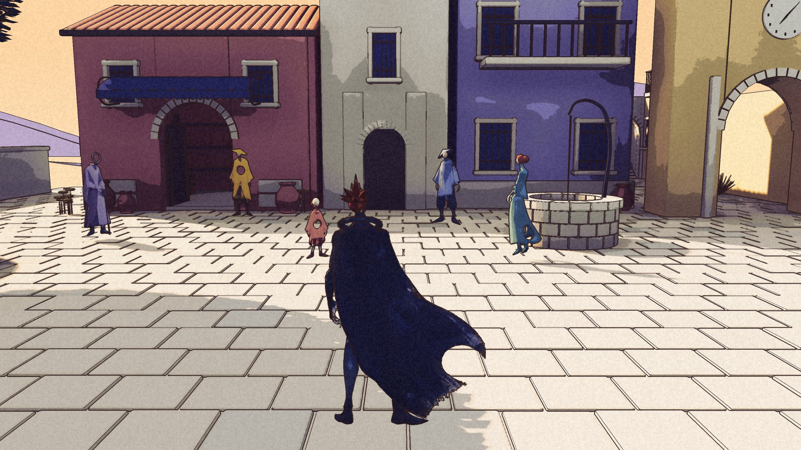

# Chimera · the record

**Live: https://projectchimera.dev/**

Chimera is a role-playing game set in a hill town that was painted before it was
built, with a hero drawn in ink who does not always stay drawn. It is being made
in Unreal Engine 5 with a painted look: ink lines, five value bands, lavender
shadows, paper grain, flat colour, no global illumination. Every figure in the
game starts as one lineup drawing.

This repository is the game's public record: a static site that says where the
build stands, what was decided, and what it looked like from the review rig on
the day it was accepted. The record is kept in order. It has been wrong before
and corrected itself.



## What is on the site

| Page | What it holds |
| --- | --- |
| Home | The hero, the status ledger, the latest updates, the first recording |
| Updates | Dated entries, one per build or decision, with frames from the rig |
| World | Havenwood's places (anchored / weaving / unwritten), the open-world regions with their v3 paintings (`regions` in `world.astro`, media from `prep_media.py --regions`), and the 2025 written world |
| Characters | Kai and the townsfolk, from drawing to game, and the cast still to draw |
| Story | Premise, Kai, Elara, the desert opening, the prologue and four acts (the 2025 outline kept folded), the endings. The chosen ending is not on the site |
| Mechanics | Temporal anchors, the loop, combat phases, echo weaving, spells, companions |
| Look | How the painted look works and how it is checked |
| Timeline | From the first documents and portraits of May 2025, through the browser game and Godot, to every update; Kai six times; the cast as first drawn |
| Roadmap | What is anchored, what is being woven, what is still unwritten |
| Download | The public demo: button to the GitHub Release dmg, size, what is playable, SHA-256. Data in `src/data/demo.ts` (first entry is shown); for a new release add an entry with the stapled dmg's byte size and `shasum -a 256` |
| Anchors | The save menu: the game's fixed anchors, then the pages you stabilised this visit |

There is also a page that is not linked from anywhere. Type her name.

## The haunt

The site misbehaves on purpose, in small ways, to match the game. All of it is
client-side, none of it leaves the browser, and all motion is off under
`prefers-reduced-motion`.

- **The hero is a shader.** The courtyard painting runs through WebGL
  (`src/scripts/mirror.ts`). Wet paint ripples under the cursor a fraction
  late. Hold the mouse down and the painting loses its colour and becomes ink
  lines on paper, the way Kai does. It also does this on its own now and then.
- **The hum.** A procedural drone, three minutes, loops without a seam, off until
  you press it. It persists across page changes. Past the chapel it drops an
  octave. Generated by `tools/hum.py` with numpy and scipy, no samples.
- **Everything else** lives in `src/scripts/haunt.ts`: page titles phase to
  outline; headings decode from block glyphs; frames tear into slices on hover;
  a second cursor answers yours from the mirrored side of the screen; the record
  corrects its own words in front of you and puts them back; the strip under the
  navigation corrupts a letter and repairs it; a clock in the corner loses three
  seconds and finds them again; the site counts your loops and notices when you
  come back; leave the tab and the title changes its mind; past the footer the
  paint stops and the engine's default checkerboard shows through; the 404 types
  out a processing log. While the hum is on, the page makes small sounds for
  what it does.

Page changes are client-side (Astro's `ClientRouter`), cut with a skip rather
than a fade. The audio element, the strip, the clock and the second cursor carry
`transition:persist` so they survive the swap.

## Stack

Astro 5, static output, no server, no database, no analytics. Fraunces and
Instrument Sans as variable fonts. Images under `src/assets/media/` are resized
and converted at build time; clips and the hum live under `public/media/`.
Deployed from `main` to GitHub Pages by the workflow in `.github/workflows/`.

```sh
npm install
npm run dev       # http://localhost:4321/
npm run build     # writes dist/
npm run preview   # serves dist/
```

Node 22 or newer. To host at a custom domain, set `SITE_BASE=""` and
`SITE_URL=https://example.com` when building.

## Post an update

1. Add a markdown file to `src/content/updates/`, named `YYYY-MM-DD-slug.md`.
2. Front matter:

   ```yaml
   ---
   title: Five drawn figures, a street, and a packaged build
   date: 2026-10-22
   summary: One or two sentences shown in lists.
   cover: ../../assets/media/street-arrival.jpg   # optional, 16:9 reads best
   coverAlt: What the cover shows.
   tags: [build, characters]
   ---
   ```

3. Write the body in markdown. Images: ``.
4. Push to `main`. The site rebuilds in about a minute.

The home page's status ledger and the `src/data/` files (characters, places,
roadmap) are written by hand. Each entry has a `status` of `built`, `now` or
`next`, which the site renders as anchored, weaving and unwritten.

## Stills and clips

- Stills from the review rig go through `tools/prep_media.py` (Pillow). It
  resizes and crops into `src/assets/media/`. Add a line there for a new frame
  rather than copying large PNGs by hand.
- Gameplay recordings go in `public/media/` as mp4, H.264, no audio. To trim a
  screen recording and cut a loop from it:

  ```sh
  ffmpeg -ss 2.4 -to 41.0 -i recording.mov -an -vf "fps=30,scale=1280:-2" -c:v libx264 -preset slow -crf 28 -pix_fmt yuv420p -movflags +faststart public/media/clip.mp4
  ffmpeg -ss 19.5 -to 25.0 -i recording.mov -an -vf "fps=30,scale=960:-2" -c:v libx264 -preset slow -crf 24 -pix_fmt yuv420p -movflags +faststart public/media/loop-street.mp4
  ```

- Clips from a packaged build: `tools/video/spec-world1-walk.json` is a review-sheet spec
  (strips of at most 60 frames), captured with the game project's `run_pkg_sheet.py` inside its
  Unreal lock and save guard; `tools/video/encode_clip.py` joins the strips into one mp4 with no
  burned-in labels (`--shots`, `--crop` for the DEV tag, `--crf`).
- Loops autoplay muted through the `Frame` component:
  `<Frame src="media/loop-street.mp4" poster="media/poster.jpg" />`. In
  markdown, use a plain `<video>` tag with the `/media/...`
  path.

## The hum

```sh
python tools/hum.py hum.wav --seconds 180 --seed 7
ffmpeg -i hum.wav -c:a libopus -b:a 64k public/media/hum.opus
ffmpeg -i hum.wav -c:a libmp3lame -q:a 4 public/media/hum.mp3
```

Three detuned low voices in D, a sub underneath, a minor second that arrives and
leaves, one far high partial, a breath of filtered noise, a tick every nine
seconds or so, and a long reverb. The last eight seconds crossfade into the
first eight.

## History

The same story has been built three times. A browser JRPG in pixel art (February 2026,
tagged `legacy-browser-game` in this repository), a native 3D town in Godot
(September 2026), and the painted Unreal build (October 2026). The record calls
this iteration.

Chimera is by [Nichalas Barnes](https://nichalasbarnes.com/).
