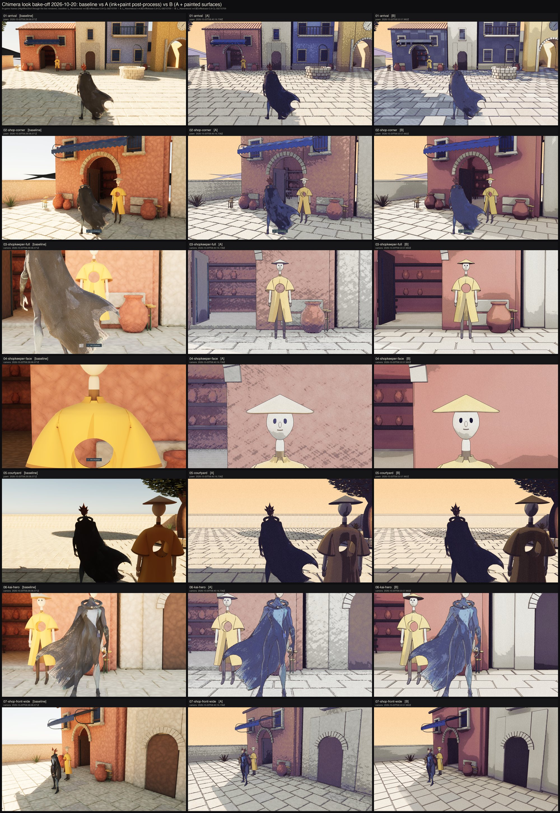

The first Unreal build had the route and the dialogue, but after sleeves, hands and faces it still looked like plastic toys. The fix was not more detail on the characters; three rounds of that had changed nothing. The fix was a bake-off on the shop corner, reviewed from an in-engine review sheet, with packaging only at acceptance.

Treatment A was a post-process after tonemapping: ink lines from steps in depth and creases in the normal, five value bands, a lavender push in the shadows, two scales of paper grain, a painted sky beyond two kilometres, and Lumen off. That alone removed the toy read.

Treatment B was A plus every surface rebuilt as a flat palette colour times a pigment tile, sampled in object space, with roughness at one and no specular, no normal maps, no emissive.

The decision came at 12:42: "just roll B". It rolled out to the whole courtyard, the Shopkeeper and Kai's material. The rules are written down as a contract, and the review rig compares every later change to the accepted run from this day.

Two things the look did not fix. The frame rate stayed around 25 frames a second with Lumen off, so the bottleneck is not shading; that is still open. And the characters' proportions were not part of the look at all, which is what the next day was about.
