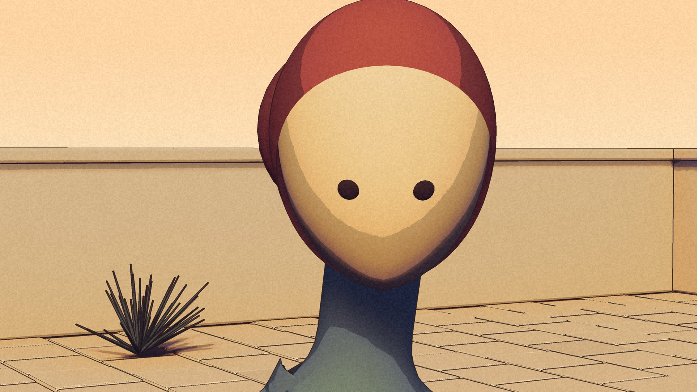

The morning started with a round of personality on the procedural residents: no mouths, drawn feet and necks and hands, two of them walking routes. Then a bake-off of fused body parts and character-only ink. The verdict on all of it was the same: they still looked like tub shapes put together.

So the townsfolk went the way Kai went on 17 October. Cut the figure out of the lineup drawing, run it through image-to-3D, project the drawing back onto the mesh as its own texture, rig it to the shared skeleton.

## What worked and what did not

The generated body carries the drawing well. Generated heads do not: they came out lumpy and perforated, and the projected face streaked. Four rounds in one evening settled it:

- **Head.** A built oval mask with two eyes and one swept bun, on top of the generated body. The drawing shows a single eye in three-quarter view; the game version got two.
- **Hands.** Built, in a shared clasp pose, on forearm stubs under the sleeve bells. Generated fingers read as gloves.
- **Body.** Generated, closed with a remesh before the drawing is projected, flat drawn colour outside the drawn view.

The rule for every resident from here on: generated body, built head, built hands, built props. Never ship a generated head or generated fingers.

The gate at 16:08 was "this is the direction; rig her and put her in the game". By 22:03 the verdict on the in-game version was "yes, do the other four the same way". The recipe was written down so that four agents could run it overnight.
