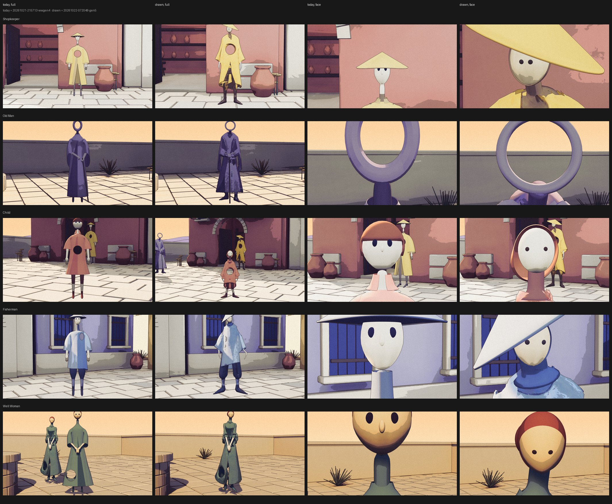
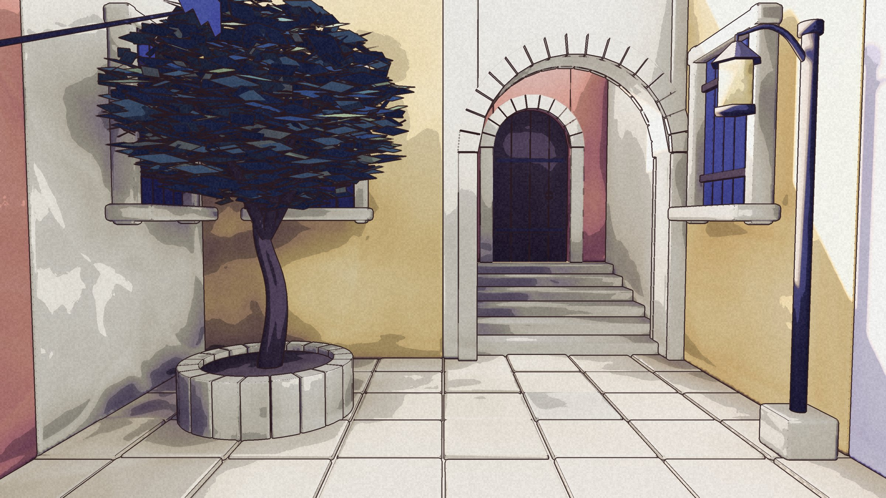

The Well Woman proved the route yesterday. Overnight, four agents ran the same recipe on the other four residents, one each: Shopkeeper, Old Man, Child, Fisherman. By 07:30 all five drawn figures were standing in their places, and the earlier procedural figures were retired to disk as a comparison baseline.

Each one keeps what its drawing gives it: the Old Man's head is a built ring, the Fisherman's hat a built cone, the Child's bob built on top of a generated body. Same places, same light, same review camera as yesterday. The verdict was "good enough, package the game now", so there is a new Mac build dated today.

## The street

The street is the first place made from the town kit instead of by hand: seventeen wall, door, step and planter pieces that snap to a one-metre grid, laid out as a short text file and imported into the level in one go. A review run on the street this morning came back clean.

## What is open

Three polish items from the composite, none of which blocked the build: the Child's bob reads as a copper cap, the Fisherman's hat is steeper than the drawing, the Shopkeeper's collar edge is ragged.

## Next batch

The direction for the next stretch is to build out a lot more at once. Batch 1 runs four streams in parallel:

- **Places.** The seaside lane down from the courtyard and the harbour at the bottom, laid out from the kit on the same continuous map, with new pieces for the quay edge, bollards, water, a small boat, an arched door and wide steps.
- **Figures.** Six new residents from a second lineup drawing, placed in the new places with names from the cast catalogue.
- **Game side.** Talk prompts that name who you are talking to, walkers that cross between places, the name of the place when you arrive, and saving where you stand.
- **Polish.** The three items above.

The rule that keeps this sane: one Unreal process at a time. The agents work in Blender and hand over files; the coordinator runs one integration chain per batch.
