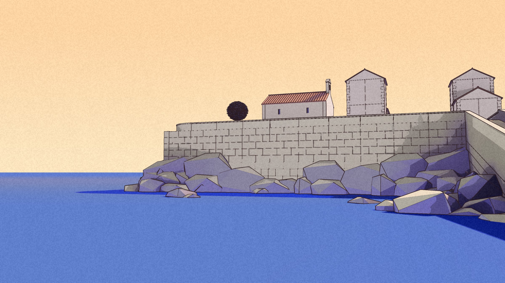
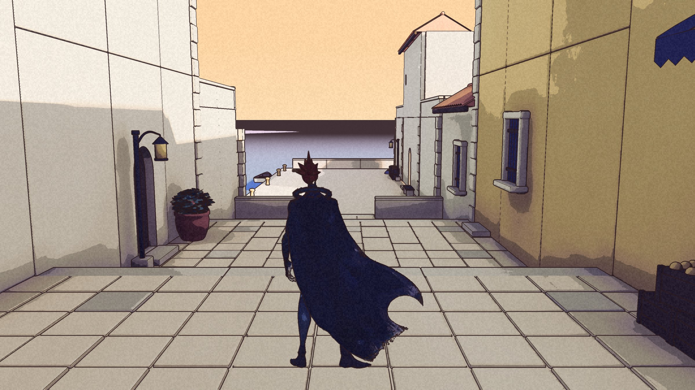
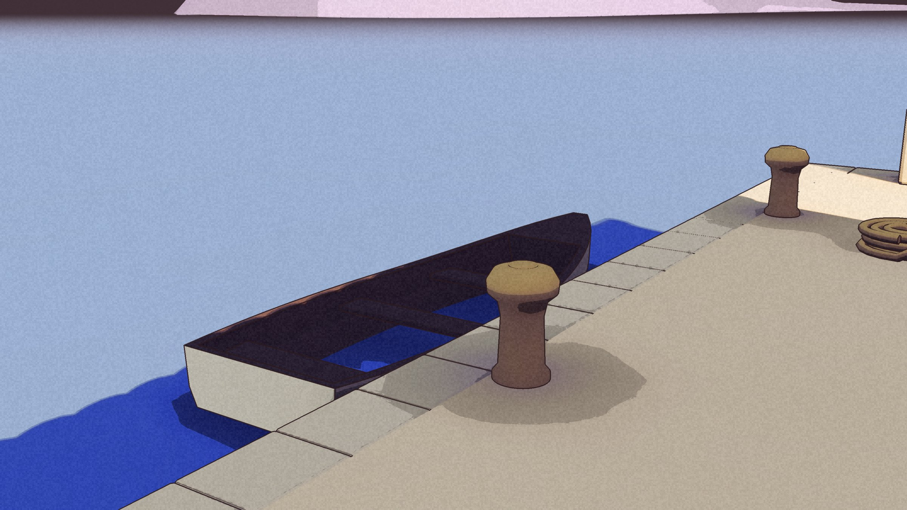
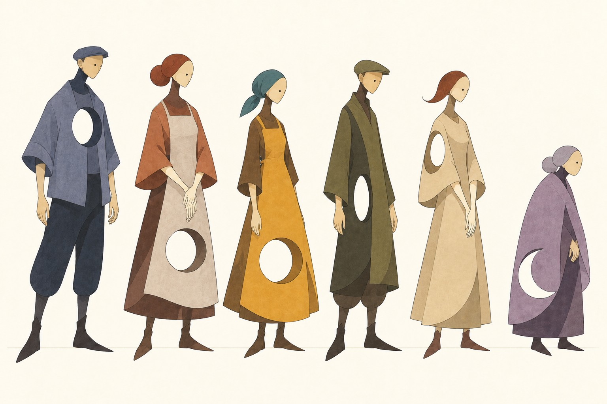
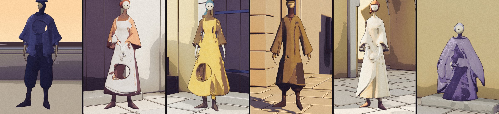
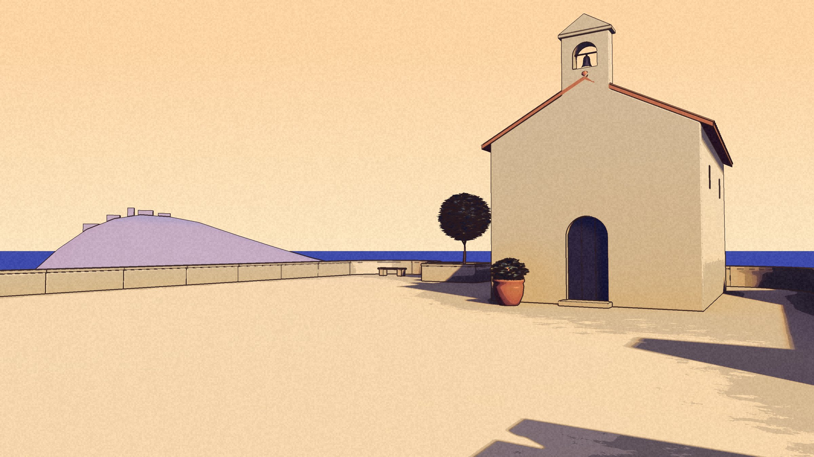
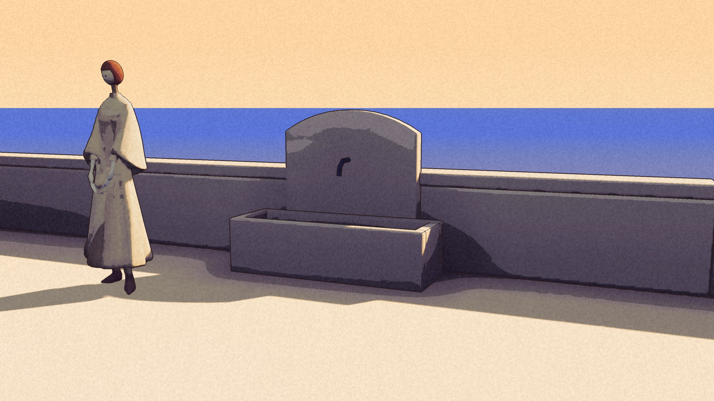
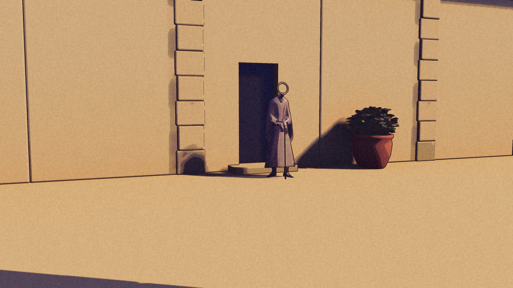
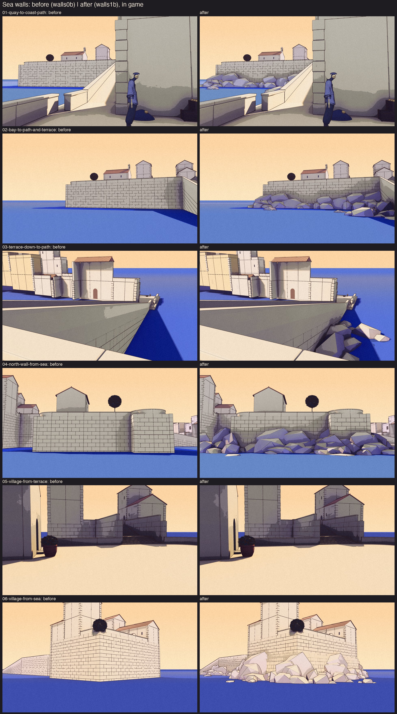
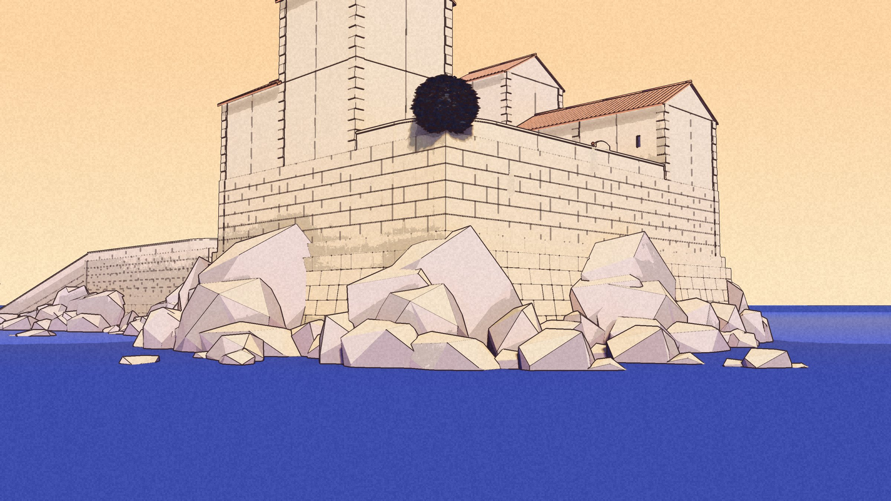

Two days, three batches, three packaged builds. On the morning of the 22nd the game was a courtyard and a street. It is now six places on one continuous map, and you can walk from the well to the sea and up to the chapel without a loading screen.

## Down the lane

The seaside lane drops about three metres from the courtyard to the water, between pale and ochre fronts, past an arched door and a run of doorsteps. At the bottom is the harbour: a quay, bollards, a lantern, a bench, a water plane and one small boat. The kit gained the pieces for all of it.

## Six more

A second lineup was drawn in the first one's hand, three versions, and one was picked. By the evening all six figures had gone through the same drawing-to-game route as the first five and were standing in their places, each with a name, a few lines and, for two of them, a route.

Sal carries sealed crates for the estate between the quay and the lane. Innkeeper Rowan keeps The Weary Wanderer and airs every room, though there are fewer guests since the roads became dangerous. Frida sells plums from a doorstep. Grandmother Edith sits on a step and does not assume you have come for advice. Rowan was meant to be a man; the drawing disagreed, and was kept. Two of the first five were given their names at the same time: the Shopkeeper is Merchant Aldric, and the Fisherman is Old Reed.

## Up the coast path

From the quay a ramped path climbs along the sea to the church square: a terrace above the bay with a small white chapel, a round clipped tree, benches and a curved lookout. Past the chapel a stair goes up to the hill village, a small square of gable houses on a causeway with a fountain basin against the end wall. Both were rebuilt from their paintings with ten new kit pieces.

The residents moved to fill them. Old Reed went down to the boat. Tom walks the church terrace, repeating what he has heard about lights near the ruins. Anna went up to the basin to watch which flowers have opened. The Old Man has a doorstep in the village now.

The save changed too. Continue used to put Kai back in the courtyard; now it puts him on the spot he left, in the place he left, and names the place as he arrives.

## Walls on rock

Seen from the water, every wall rose straight out of the sea: six and a half to nine and a half metres of plain coursing with nothing at its foot. The painting shows a low wall on natural rock. This morning the walls got a stepped footing and a shore of large flat rocks, a hundred and seventeen of them, placed so that no two sit the same way. Nothing Kai walks on moved.

## How fast

Each place was measured standing still in the batch 2 build, in a 1280 by 720 window on the M1 Max. Every one held the display's 120 frames a second, with no frame over a thirtieth of a second. That is not a claim about full screen at Retina size, or about walking; those are next to measure.

## Next

The chapel door opens. Behind it is a dim room with benches and one window facing the late sun, reached by walking up to the door and pressing E. Off the lane, Dyers' Steps is being built: a stepped court of drying cloths, dye vats and a loom. Both have their first frames from the rig. Neither has passed its gate.
