Since the town reached the sea on the 24th there have been seven more batches and ten packaged builds. Havenwood has twelve places now, four of them behind doors, and a road up to the estate. A patch of desert lies 7.4 kilometres away on the same map, where nobody in the town can see it. Not all of it is accepted. Where Nic has not played a thing yet, this post says so.

## The first door

The chapel door on the church square opens. Walk up to it, face it, press E. The screen fades, and Kai is in a small dim room with benches, an altar block and one tall window facing the late sun. Nic passed it at its second look: lighter wood on the benches, a wider window, stronger lavender on the floor, a softer glow.

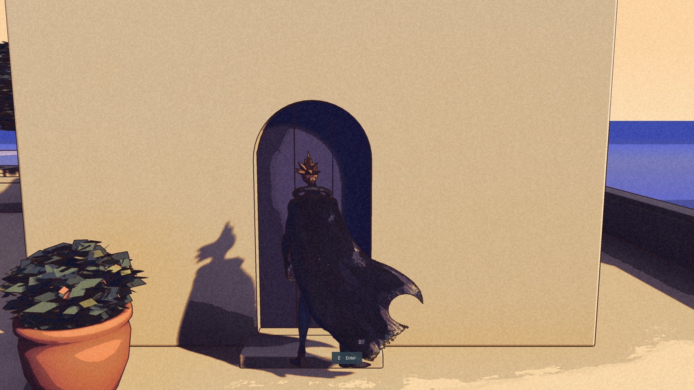

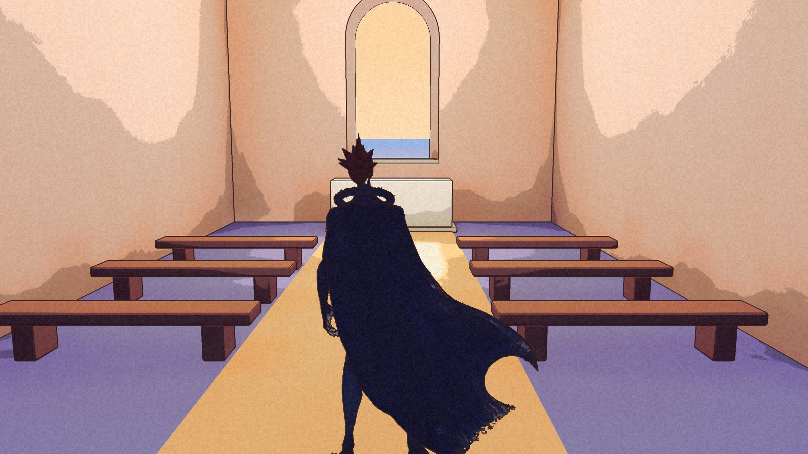

The same morning, a bug. Kai could jump the church terrace's ninety-centimetre parapet and fall into the sea, and the save kept him there, under the water. The sea now catches him and puts him back. Later the parapets stopped letting him over, and Continue learned to recover a save left somewhere with no floor.

## Dyers' Steps

Off the lane, a stepped court of borrowed colour: a drying frame hung with indigo, coral and cream cloth, two dye vats, a loom, pots and plants. It passed at its second look, after the plants, more cloth and a deeper indigo. Through its arch it still sees rocks and a wall, where the painting sees the town going down to the sea.

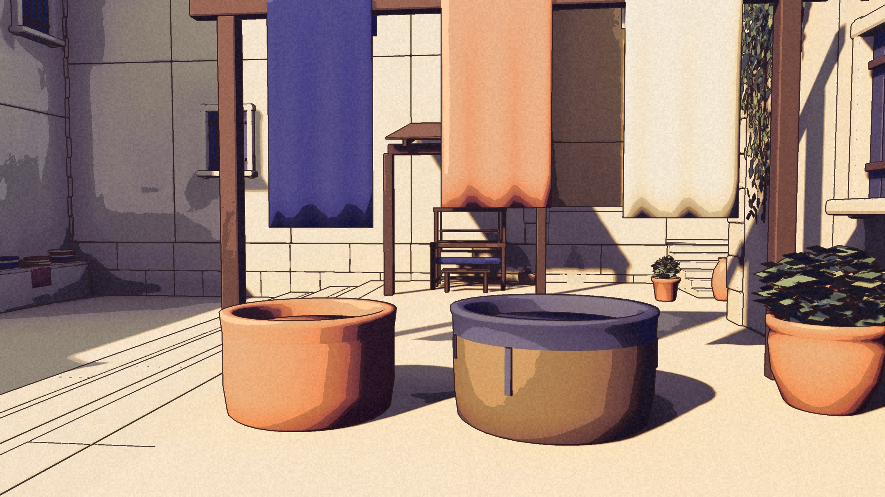

## The shop, and the first swaps

Through the door under the awning: coral walls, a pale counter, two shelves of jars, one bright window. The bell on the counter has no clapper.

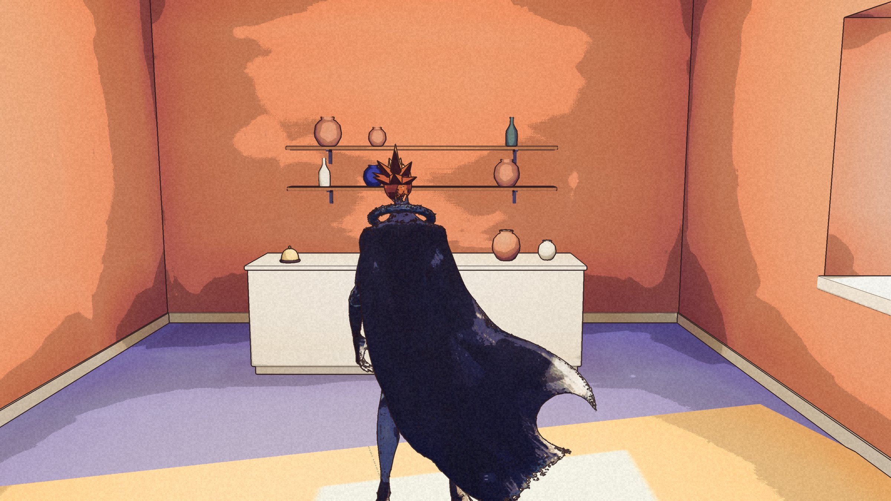

Outside it, the first barter, called Swaps. Frida gives away bruised plums from her second bowl. Rowan wants them, because Frida will not take Rowan's money, and pays you in plum pudding instead. Merchant Aldric swaps a chipped cup for a short length of line from the quay. The Child wants something that floats, the cup or a pale bottle the tide left at the harbour, and gives you a skipping stone. The lines are first drafts. Swaps is the working base; the menus change after Nic has played it.

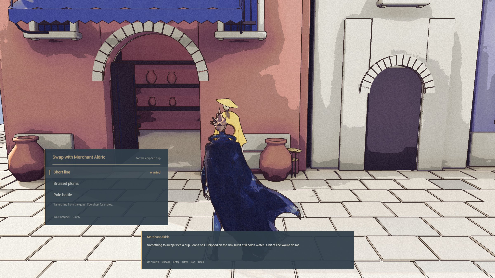

## Up the ladder

A rose-coloured door at the end of the street opens onto an alley of steps, and the alley onto a ladder. At the top is Lumina's still garden: a walled roof with a stone bench, a dry fountain, beds of blue flowers, and the bay over the wall. In the story this is where Kai wakes. The shop and the garden are built and packaged. Nic has put off judging either until a playtest, so neither is accepted yet.

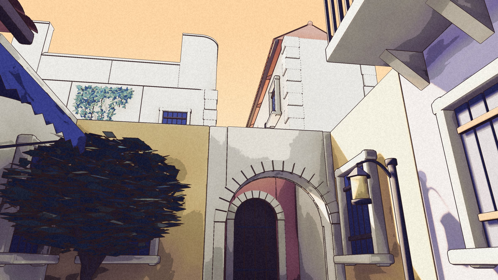

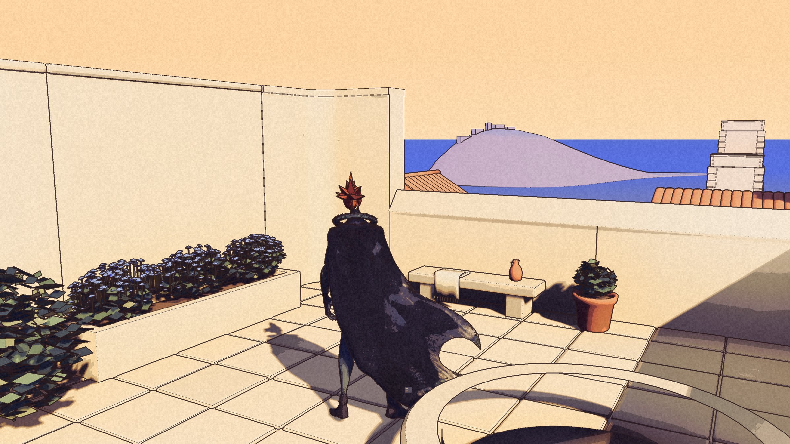

## The Rusted Cog

The third interior is Greta's tavern: a coral hearth with a retired mill wheel above it, dark teal beams, a bar with stools and a barrel. Nic: fine for now. Greta came that evening. Her drawing was a draft made for Nic to correct, and Nic accepted it as drawn.

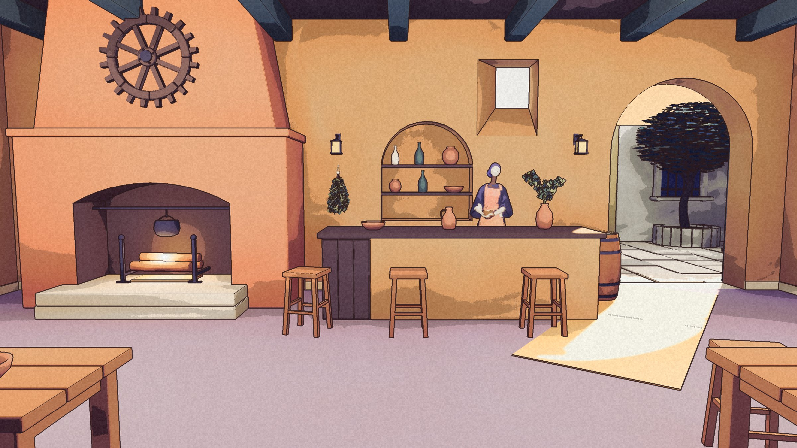

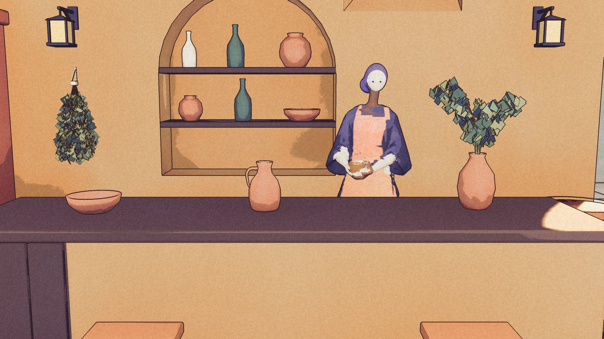

## Three more

A third lineup, drawn on the 25th and accepted as drawn: Father Silas for the chapel, and Old Ferris and the Hooded Stranger for the Cog. In the game they first came out a little off, with long dark necks, paler cloth and hair like a white cap. They went back through the figure route two or three times each before Nic passed them.

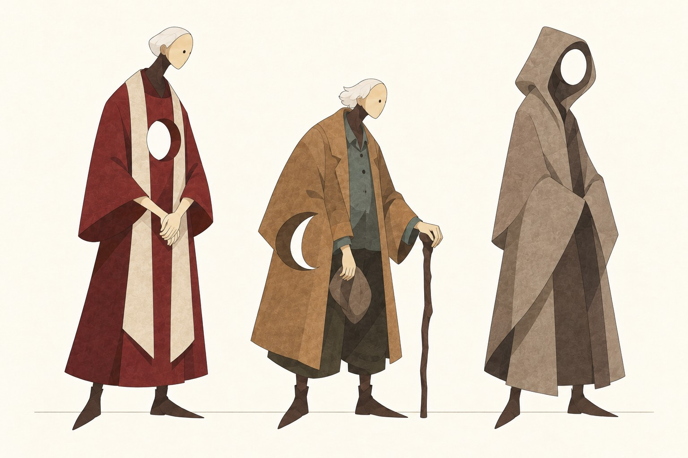

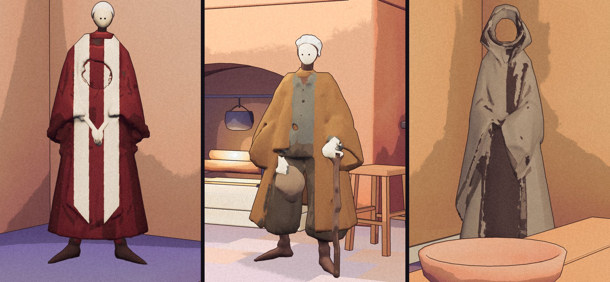

Silas keeps the chapel's books, which have lasted through a good deal of mending. Ferris saw lights near the ruins, and says the rest was added over drinks. The Stranger does not speak; every line is a stage direction. On the 26th Nic looked again and asked for the Stranger darker, more ominous. That is being done. Fifteen residents now.

## The gate

From the top of the town a road climbs between retaining walls to the Lumina gate, with lamps, a statue in an alcove, cypresses, and the bay behind. It was built from the first of three paintings; the second became the view back from the gate. Nic accepted it.

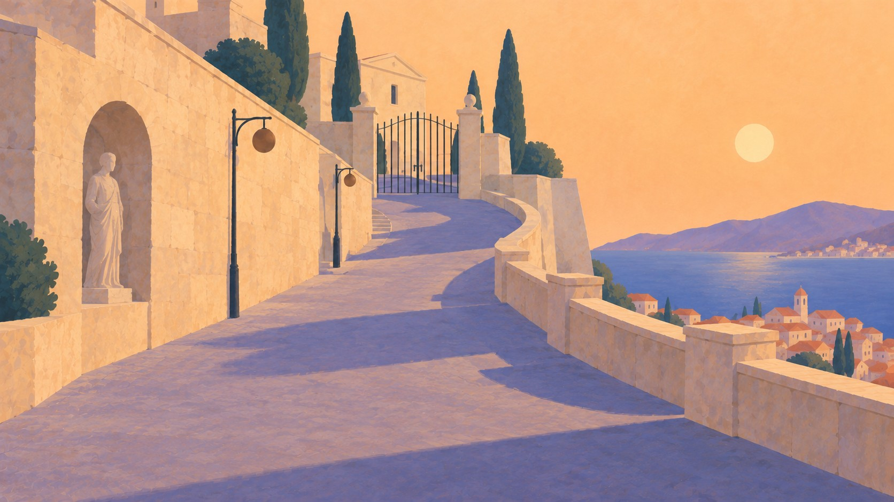

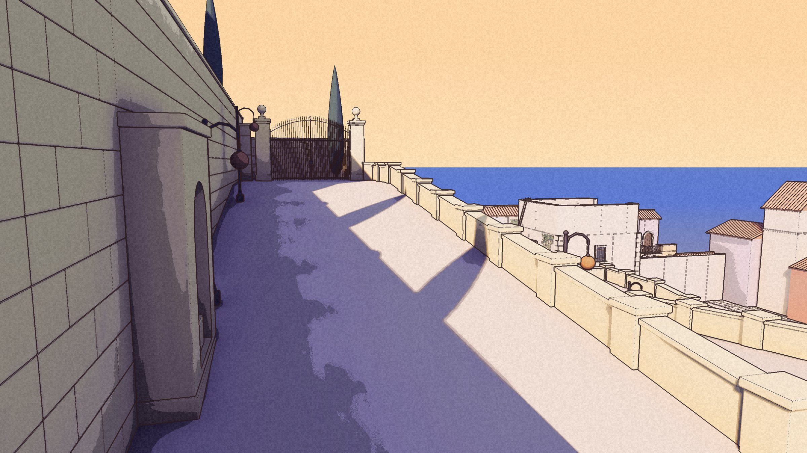

The gate stays shut. Try it and a line tells you the estate is home to the region's nobility, and you have no business here. Yet. It is the first thing in the game Kai cannot do.

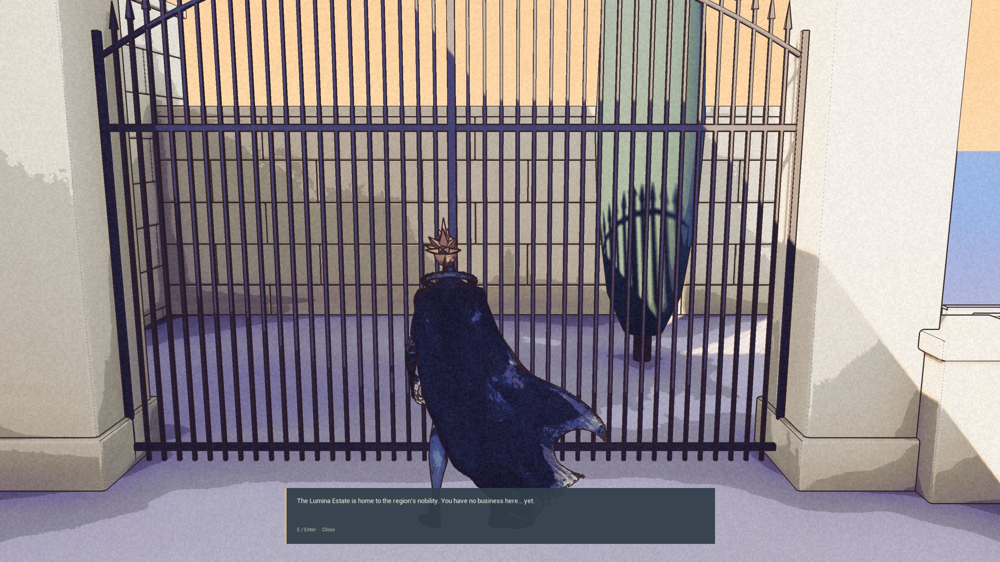

## Kai moves differently

Kai's movement was rebuilt on motion-capture clips retargeted to his skeleton: a breathing idle, a walk, a run and a jump, with his feet set on the steps and his cape on a simulation. Nic left the choices to be fixed after playing, and on the 26th looked at it. The cape flickers at rest instead of hanging. The arms swing too much. The jump is too acrobatic. A second pass is under way. One of Kai's arms has always been under the cloak; from the next build it stays there on purpose.

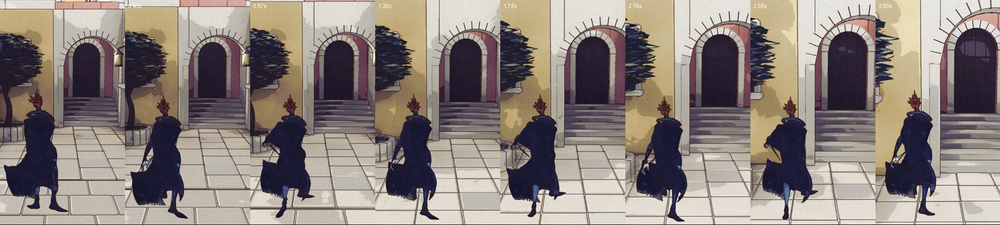

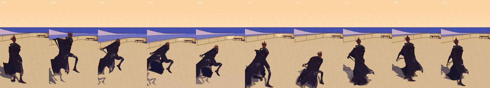

## Where it begins now

On the 26th a working master direction rewrote the shape of the story: a desert prologue and four acts. The game now begins with Kai walking across a desert until he collapses, and then waking in the garden. [The story page](/story/) has the new shape and the opening. It does not have the ending. That was chosen too, and stays off the record until it is built.

The desert has a first slice: a walkable patch of sand, rocks, dry shrubs and dunes, 7.4 kilometres from the town and cut off by distance, so neither can see the other. A flat outline stands on the far ridge, a proposed detail and nothing more. The slice is reached only from a new development menu that jumps Kai to any place with saving off. Nobody has played it. Its frame time is not measured: the run could not bring the game window into focus.

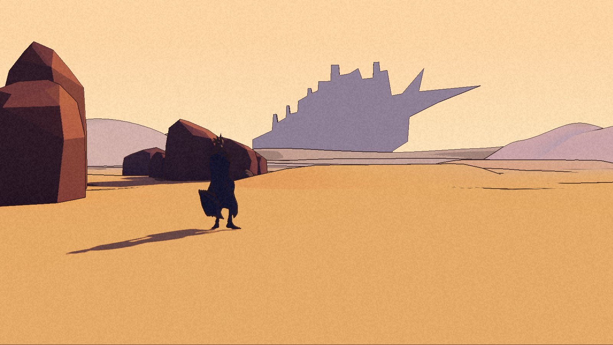

## Next

Kai's second pass and the darker Stranger. Then Nic plays everything that is built and not yet accepted: the shop, the garden, Swaps, the movement and the desert. In the desert the far ridge reads as a flat band and the sky is paler than the painting. Those come before any tremor.
