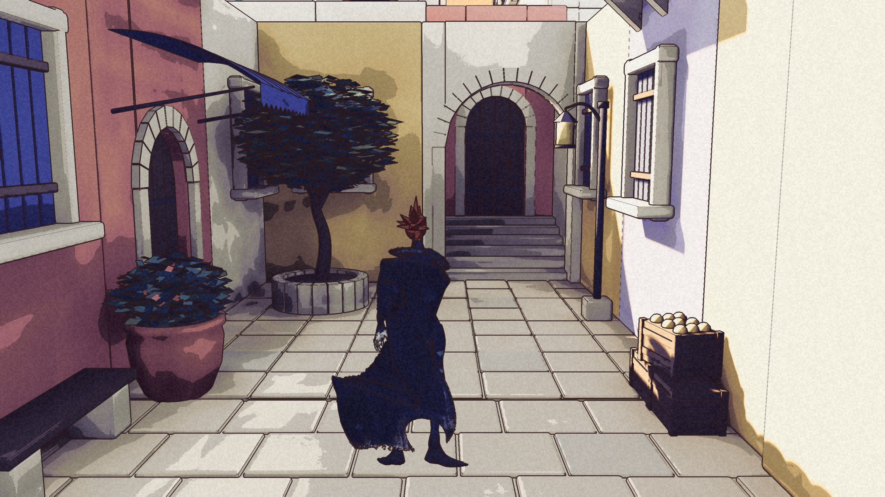
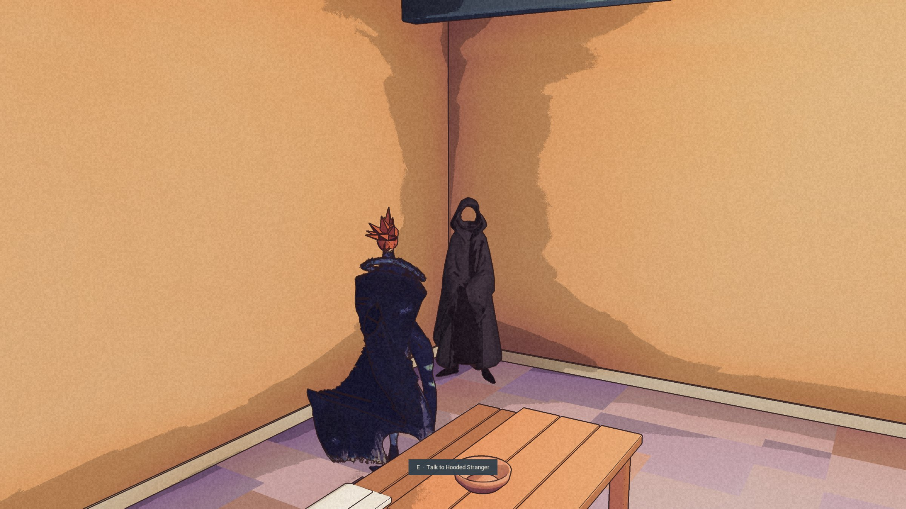
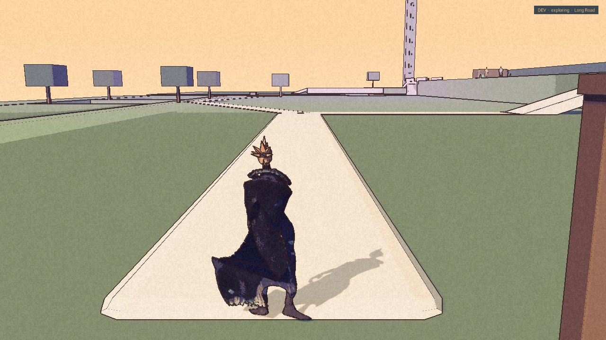

The cape used to change sides while Kai stood still. The review strips had missed it. They advanced the game in even steps; playing did not. This time the check ran in real time, and the flicker showed itself.

Batch 11b is packaged and its launch check passed. The cape now hangs still at rest. The measured walking arm swing is about half what it was. Kai jumps upright, with his arms held closer, at the same height as before. He still lands in a deep crouch. That part remains for Nic to judge.

The covered arm is held across the body in every state. At a run the cape can lift enough to show the forearm. There is no new ability here, only a deliberate pose.

## The Stranger

The taupe cloak has become charcoal-violet. The darkest tests lost the folds; the chosen one keeps them. The hole in the hood has not acquired a face.

This is a frame from the packaged build. Nic asked for darker and more ominous. The new look is built and packaged; it is not accepted until Nic has judged it in play.

## A road made of boxes

The Long Road is a separate exploration prototype: a loop 245 by 140 metres, with two branches, three river crossings, a cart to repair, a hidden hollow and a return to the village. It has a packaged build and a clean launch and rendered review. Nic accepted the movement and layout as a base to build on. That is not approval of finished scenery.

This frame is the first package. The trees are boxes. So are much of the road's surroundings. This is the accepted base, not finished scenery.

The route keeps its changes only for the session. A normal way into it from the campaign, a way back, and a decision about what to save are still ahead. Nic's verdict on movement here does not settle every detail in Havenwood.

## What was measured

A focused frame-time run compared the first Long Road blockout with Street 1. Each view had a fifteen-second warmup and a forty-two-second sample, in a 1280 by 720 window on the built-in 120 Hz display, on AC power with Low Power Mode off.

| View | Median | 95th percentile | Frames slower than 16.7 ms |
| --- | --- | --- | --- |
| Street 1 | 8.48 ms | 19.8 ms | 533 of 4,161 |
| Long Road arrival, blockout | 8.34 ms | 8.95 ms | 3 of 5,070 |

The display caps the faster result. These are sampled views, not a whole-route playtest, and they do not measure a finished environment. The desert's earlier frame-time check is still open.

What comes next is on the roadmap. The unapproved concepts and the story's answers stay off the record.
