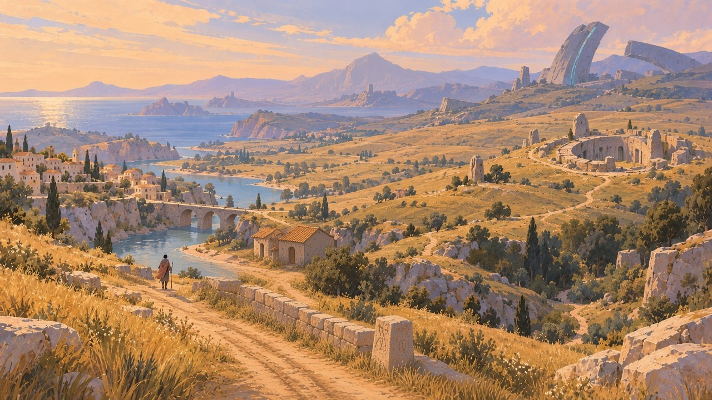
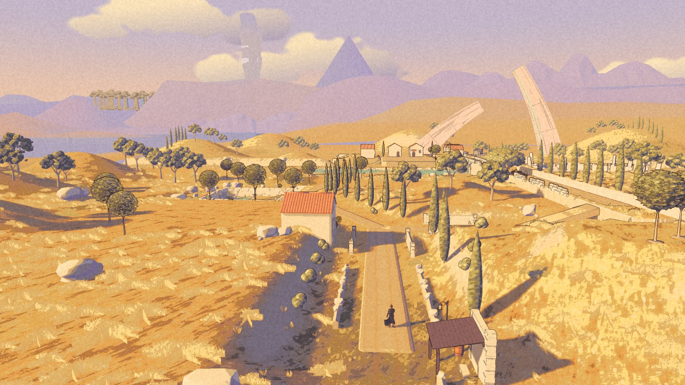
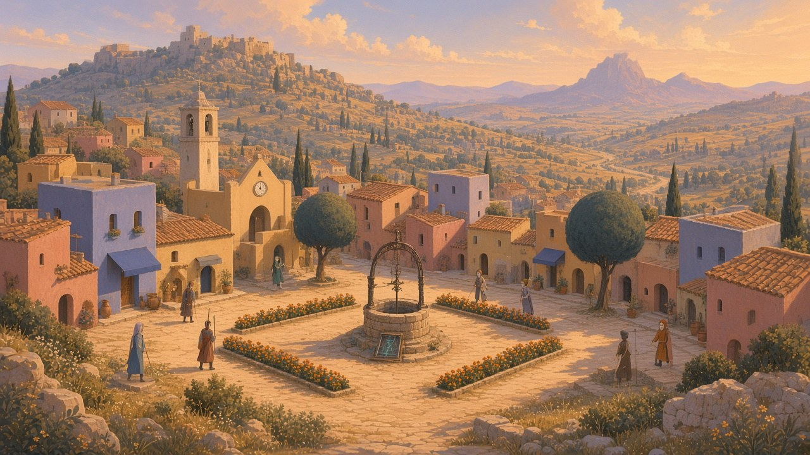
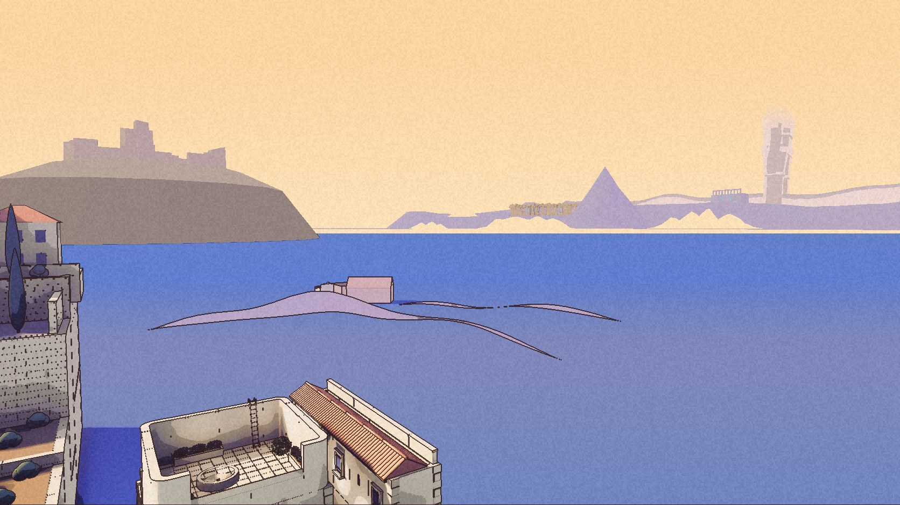

This morning Nic stopped the polishing. The Long Road had been moving toward its paintings one patch of grass at a time, and the rest of the world did not exist yet. The new order: the world first. Rough shapes in the right places, haze, long sightlines. Detail after.

By half past eight there was a build. world1 puts every region on one map. The town and the Long Road are where they were. The High Pass, Shadow Country, the Salt Road, the Archive Forest and the Hanging Sea stand in the distance as painted silhouettes, seventeen pieces in all. The Weeping Colossus stands on its own range, fifty kilometres from the town square. None of it can be walked to yet. Where each one stands is a first guess, kept as data so it can move, and Nic has not reviewed it.

## From the road

The arrival on the Long Road, after its painting. The lone peak is ahead, the amber grove of the Archive Forest is on the left, and the Arc's broken spans are on the right. The Colossus is the pale shape standing in the cloud.

## Walking it

Sixteen seconds on the road in world1, in four cuts: standing at the arrival, walking toward the peak, the low path at a run, and the bridge. In the last cut the Colossus is the tall shape in the cloud, left of the peak. It was recorded from the packaged build at a fixed step, fifteen frames a second, so it says nothing about frame rate.

<figure class="frame">
  <video src="/media/world1-walk-2026-10-27.mp4" poster="/media/world1-walk-poster.jpg" controls muted playsinline preload="metadata"></video>
  <figcaption><b>The Long Road, world1, 27 October.</b> The arrival, the walk toward the peak, the low path, the bridge under the Arc.</figcaption>
</figure>

## From the town

The painting of Havenwood puts a ruin on the hill above the town and a peak to the right of it. From the top of the town, looking east across the harbour, the game now has both, in the same places. The Colossus is far off on the right, over the town's own sea.

## What it costs

Nothing measurable. In the street, none of 5,056 frames took longer than 16.7 milliseconds. At the Long Road arrival, 7 of 5,026 did. The last clean sample, from Long Road 4, had 12.

## Not yet

The High Pass has its shapes, but from up there they are still flat lavender blocks, so they are not shown here. From the road, the Long Road's own hills hide the arcade of the Shadow Country. The paintings are the targets: where the paintings and the written concepts disagree, the painting wins.

## Next

Nic looks at where everything stands. Then the Long Road questions that were set aside this morning.
