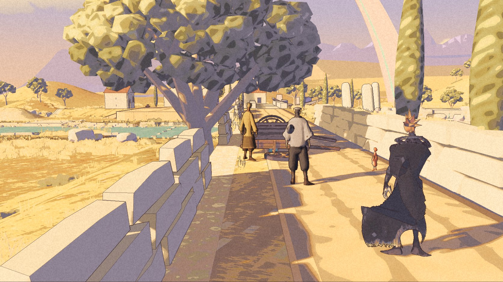
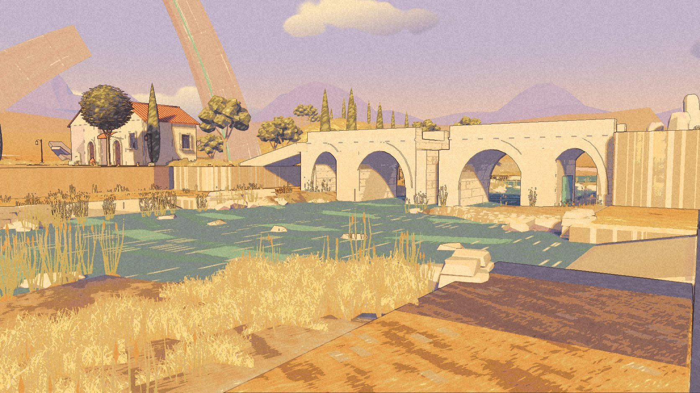
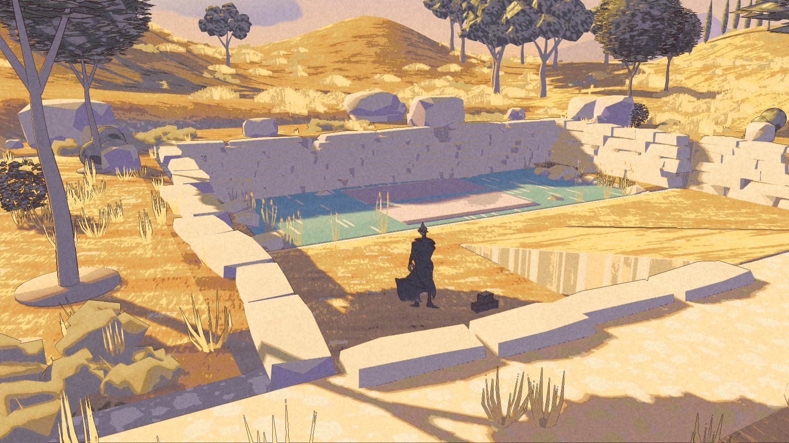

Yesterday the Long Road was green boxes. It has kept some of the boxes. The grass has learned another colour.

Five more packages followed the first blockout. This is Long Road 6, built on 27 October. Its launch checks passed, the review found no missing assets, and Continue returned to the courtyard. It is built and packaged; it is not accepted until Nic has played it.

## After walking it

Nic walked the second build from the arrival to the river village twice. The upright jump was worse. Some houses stood below the square where Kai stood. Both changed in the third build.

A running jump now leans into the travel and raises a knee. A short landing dip replaces the deep squat. Jump height and air control did not change. The village houses stand on the square's plane, with banks down to the valley.

Nic's next verdict was “ok looks good more or less. got stuck here”. The seal passage had caught Kai. A later pass repaired it, and a route check now tests the way through and back. A clean check is useful. It does not replace the next walk.

## What grew around the road

The roadside shelter has a roof. There are shoulder walls, river arches, quays, houses and trees. The winch moves, the seal sinks, and the repaired cart can return to the village with its three people. The return has its own lines.

Then the work turned toward the paintings: golden ground, pale stone, lavender distance, olives and cypresses, a softer sky and longer shadows. The Arc reaches above the village. All the new frames here come from the sixth packaged build.

The river bends now. Reeds and glints break up its surface. Some straight bank edges remain. The hollow and the ring are further behind: dressed and lit, but still made of stacked blocks that show themselves.

The coordinator judged the arrival closest to its painting. Those judgments came from five fixed cameras. They are not Nic's acceptance, and they do not settle how the scenery looks from every path. The shape of the hollow and ring, the sea colour and the painted surface detail remain decisions for him. The scenery milestone closed with those decisions parked.

## The sample that counts

A quiet comparison accepted the fourth build's arrival sample. In a 1280 by 720 window, on AC power with Low Power Mode off, it recorded a median of 8.32 milliseconds per frame, a 95th percentile of 10.67, and 12 of 5,031 frames slower than 16.67 milliseconds. The display caps the faster result at 120 Hz. This is one sampled view, not a whole-route benchmark.

The sixth build still has no accepted clean sample. One comparison lost focus; another had a busy background process. Its median stayed near 8.3 milliseconds, but that does not close the performance question. The fourth build's accepted result belongs to the fourth build.

The route still keeps its changes only for the session. A normal way in from the campaign, a way back, and persistence remain ahead. The scenery has moved on. The record leaves those doors open.
