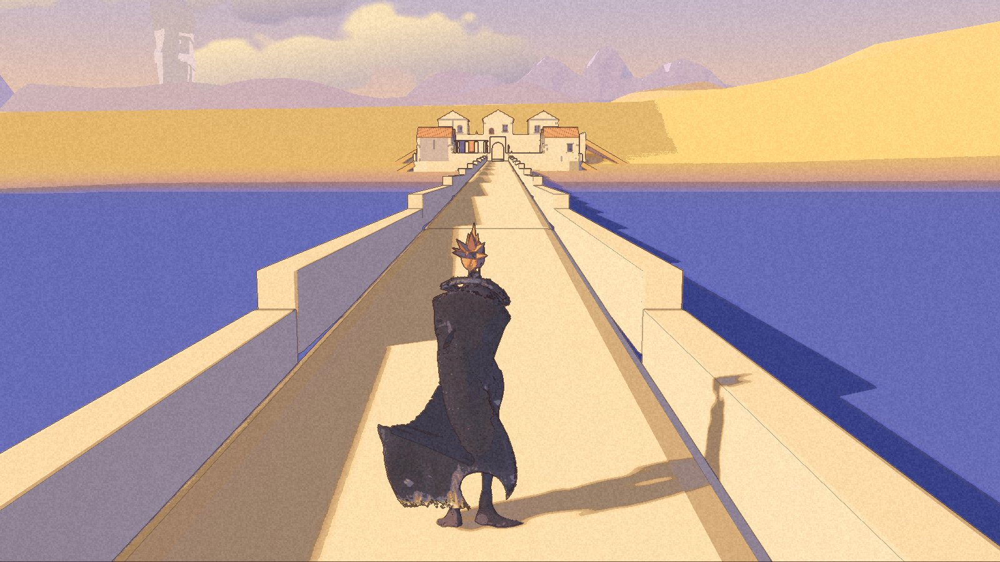
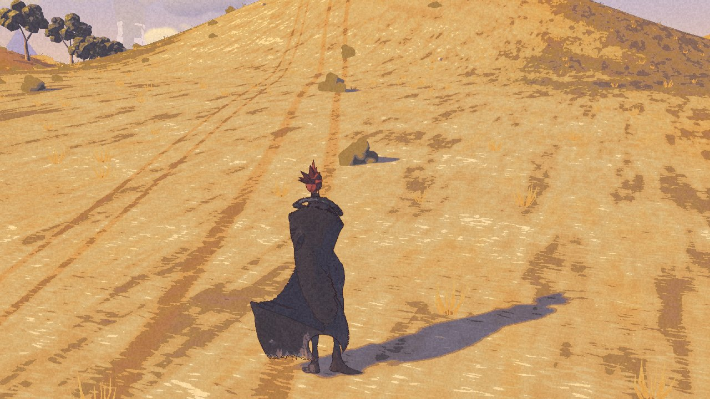

The last entry left the Long Road loaded but out of reach. There is a road to it now.

A causeway runs 1.16 kilometres from the harbour quay, through a gate and out to the Long Road. The packaged check walked from the quay to the repair stop and back: eighteen legs, no sea catches, no doors, no menus. The change of look happens under the gate. Continue restored Kai at the quay, halfway along the causeway and at the arrival.

That connection is in [Chimera Demo 0.1.0](/download/), released on 27 October for Macs with Apple silicon. The screenshots in this entry are from **par2, a newer internal Development build**. Its new settlement and later polish are not in the public download.

## The walk is not the verdict

Nic played the demo candidate. The causeway felt long. Kai seemed to hover and shiver, his stance was stiff, his jump arm needed to reach forward, and the residents read as statues. The sea needed more life.

The road passing its checks did not answer those notes. It proved a connection. It did not prove that the journey was worth its length.

## Across the water

Par2 packages a small settlement at the foot of the ridge. There are houses, a hall, a jetty and five placeholder residents. It has no settled name or cast yet.

The packaged check reaches this jetty without a fall. An earlier build could leave a hole in the parapet when the settlement was absent. In par2 the opening belongs to the settlement: without it, the parapet stays whole.

The settlement data now travels inside the app. Its launch check no longer depends on loose files outside it. This proves that the blockout loads. A hand-played visit and travel through its doors were still open at the par2 gate.

## Feet, faces and ground

Kai has foot and stance corrections, and a modest forward reach of the visible arm in the jump. A larger reach stretches the sleeve and cloak, so that limit remains. The residents no longer run their idle motions in step. They turn their heads toward nearby Kai.

Terrain bands and shoreline work are also in par2. Regional climate values blend along the causeway. That is groundwork, not a finished weather system.

An optional development battle prototype is packaged too, with three patrolling enemies. The packaged smoke test loaded its data and reached the ready state. Hand-played combat remains unproven. Nothing here announces a new public combat release.

## What the package proves

Par2 built and launched. The eighteen-leg walk and all three Continue checks passed. Nic has not accepted this build yet.

There is no clean performance result for it. The machine was busy during integration, so no new frame-time numbers were taken. The earlier coast-road comparison was also under load. Earlier fast samples belong to their own builds and views.

The public demo stays at 0.1.0. The newer work waits for its own playtest. The road has reached somewhere; the record has not called it finished.
