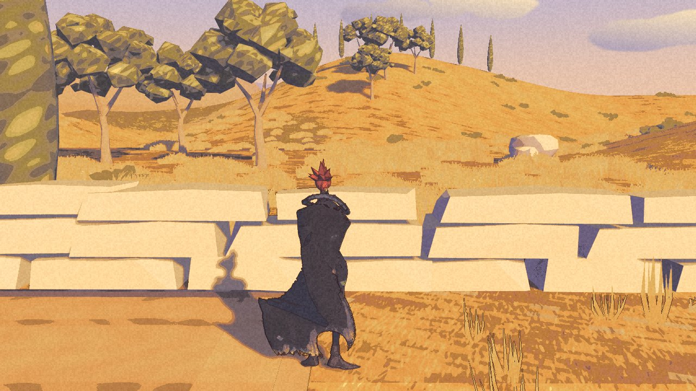
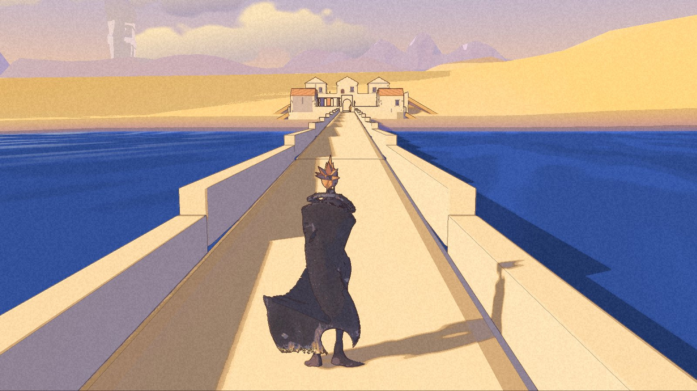

The grass has begun to move. The town has not.

Nic approved wind sway on the Long Road and chose an overcast direction: the same painting, grey and soft. Rain is for later. Five internal packages, par3 through par7, now carry the next pieces of that work.

**These are Development builds. Par7 built and launched cleanly; Nic has not accepted the build.** All three pictures here come from its packaged checks. The [public download](/download/) remains Demo 0.1.0.

## Wind beyond the gate

The Long Road now carries wind in its region data. Grass, reeds, scrub and tree crowns move. Havenwood stays calm, and the wind rises along the causeway as Kai crosses between the two regions.

A still picture cannot prove the sway. The recorded motion strips do: foliage moves while the ground and walls stay put.

Par7 also carries a thirty-second blend for a change of weather entry. The current road has one entry, so this is preparation for a change, not a weather cycle already running. Overcast can be selected in the development build. It greys the sky and cools the scene, but the cast shadows still have hard edges. Soft is not finished.

## The sea is a candidate

The new sea treatment entered par3 and remains on in par7. It brings painted surface detail to the blue water. The review still calls the harbour more saturated than its painting, and the darker drift patches too much like soft blotches. Nic has the eye call.

Shore wrack is packaged too. Neither addition has a clean performance result. A changed surface is not a measured cost.

## A clearer threshold

The settlement has gained ledgers, moved door landings and a correction to the hall-door camera. Both doors were exercised in both directions in the development game. The invisible parapet caps still stop Kai, but no longer push the camera into his cloak. Those changes reached the later packages.

Two of the five placeholder residents now stand by the hall and the gate. They are still placeholders, with a shared body and idle. The review finds one well placed in the arch and the other more like a bystander. The pale wash around the town reads more as sand than worn earth. The blockout has gained detail; its look is still an open decision.

## The checks have a clearer picture

Par7 passed the eighteen-leg quay-to-road walk, the jetty check and all three Continue restores. The Continue captures now show Kai after he has settled, instead of relying on the restore log while the camera catches up. The image-comparison rig also repeats more closely after its timing was fixed. Its five checked views cover the Long Road, not the settlement.

Nic tested par4 earlier in the day. He called it testing, not playing; that is not a blanket acceptance. The optional battle prototype remains in the internal builds, with its own acceptance still open.

No new frame-time result is claimed. The package checks ran, but the machine stayed too busy for the quiet performance test. The grass moves. The number beside it is still blank.
