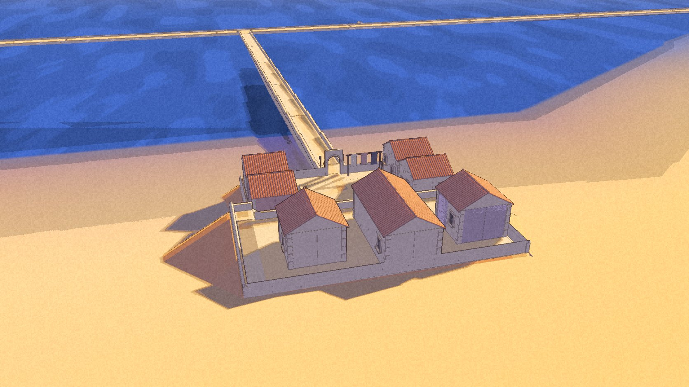
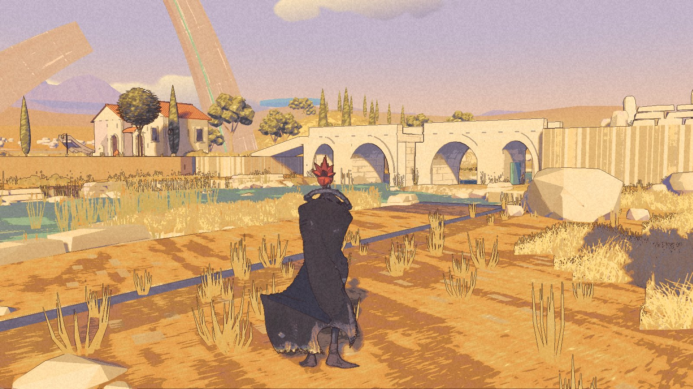

The hall has benches now. The books have somewhere to wait.

Nic tested par7 on 28 October and said it all looked good. The hall keeper stays at the corner, the watcher stays by the gate, the pale ground wash stays, and the view past the parapet at the hall door is fine as it is. The wind stays too.

Two later internal packages, par8 and par9, carry the next work. **Par9 built and launched cleanly. Nic has not accepted these newer changes.** The [public download](/download/) remains Demo 0.1.0.

## Through the hall door

The room has ledger tables, benches facing the lectern, stools and a hearth. It reads as a place used in order. There is still a grey patch high on the back wall. Furnishing the room did not finish its surface.

Crossing indoors now quiets the wind and haze and lowers the exposure. Par8 introduced that change; par9 makes the entry quicker, with a longer return to the outside light. The hall's packaged check enters, settles inside and leaves again. The camera's exposure still takes a little longer to settle after the door transition, so a shorter transition has not removed every visible shift.

A development-only climate readout can show the current state while testing. It is off by default. It is not a new player HUD.

## The paths lose their outlines

Par8 put thin path surfaces through the settlement. Their heavy edges made them read as slabs. In par9 the outline is gone, and the path colour washes over the ground beneath.

The review finds them too faint from this ridge. The jetty and square keep a little warmth; the cove path almost disappears. This is a new open look decision, separate from the ground wash Nic already kept.

## The river follows

The river's painted bands now drift and break with the wind. A reviewer checked the packaged sequence and found the water moving. The sampled water area is small, so the record claims motion, not a precise percentage of the river. In the calm comparison, the river view remains within the rig's repeat noise.

These are river changes. The wind direction Nic approved stays as it is.

## What passed, and what did not measure

The packaged Continue checks passed at all three saved positions. The route walk, jetty check and hall entry-and-exit check passed too. The two close views here are package captures; the ridge picture is from the integrated par9 review suite.

That suite now includes the settlement. Its automatic verdict had a fault: it read none of the comparison rows and still reported success. The reviewer read all six results and confirmed they passed. The numbers support this build; the automatic check still needs repair before it can be trusted for the next one.

Frame time was not measured on a quiet machine. Par9 is a checked internal package, not a new public release or a completed playtest. The room is furnished. The record leaves the remaining marks visible.
