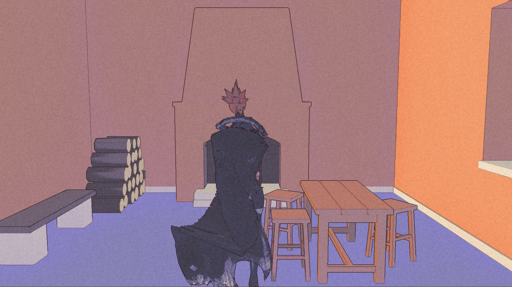
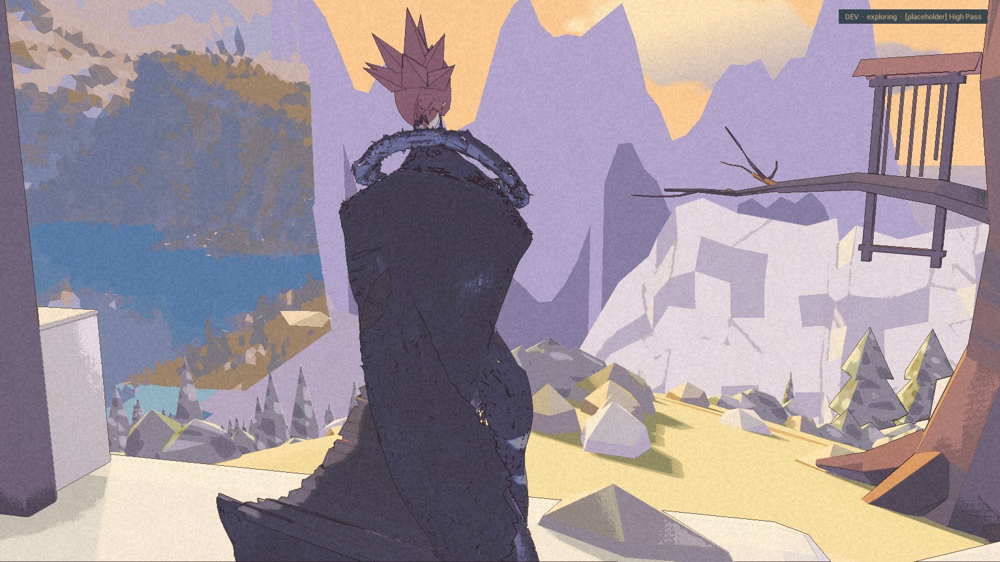
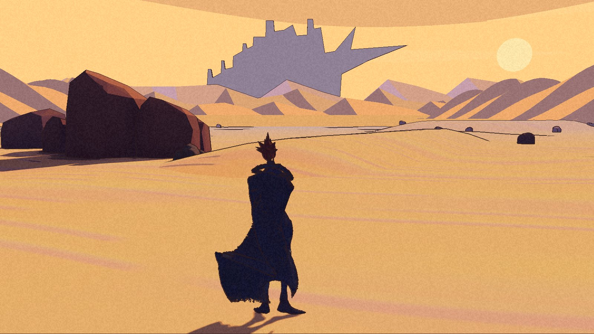

The High Pass used to be something on the horizon. Now it has a doorstep. There is a room behind this one too.

Par11 and par12 are built and packaged, with launch and follow-up checks passed. **They are internal builds, not accepted by Nic yet.** The [public demo](/download/) stays at 0.1.0. None of these additions changes that download.

## Up at the refuge

A terrace, stair and switchback lead toward a lookout above the lake. Across it stand the gateway and snow peaks. The refuge has a hearth, stacked logs, a table and stools.

The packaged review enters the room and leaves again. A separate follow-up uses the development area picker to reach the terrace. That matters: the first pictures came from the review cameras, which did not prove that the menu could take a player there.

This is not a walking route from Havenwood, or a hand playtest of the pass. Nic’s confirmation of the region remains open. The massif and lake still break into hard facets. The bright orange shape inside the arch looks detached, and lavender shapes cross the refuge wall. The pictures keep those marks.

## The desert turns amber

Par11 replaced the flat ridge with a broken crest. The dune banks have a light face and a shadow face. An amber sky, a low sun, still sand strokes and sixteen stones bring the slice closer to its painting. Par12 carries that work forward.

The distant city is still a flat cut-out. The near rocks go very dark in shadow. The strokes read mostly near Kai. The desert is closer, not complete.

All four pictures here are from the par12 package.

## The wind remembers

Winning one fight at the ford now eases the Long Road wind to a breeze over thirty seconds. Quit and Continue keep the cleared flag and the breeze; New game restores the wind. The packaged sequence passed in both builds.

The enemies still return after Continue, even while the breeze remains. The encounter rule is not settled. Keepers’ Cove now has its name in the packaged picker and place card. Par12 also stops an old place card appearing when Continue restores Kai between places.

These internal builds write a newer save format, which par7–par10 cannot read. The test launchers copy the save first and guard against opening the older builds with it. Opening an older app directly bypasses that guard. The successful Continue checks are not a claim that every backward path is safe.

## The remaining measurement

The route, Continue, interior and fixed-frame checks passed. The reviewer confirmed the High Pass door evidence after the window script had read the wrong log; the later picker check passed too.

Small changes in three comparison frames sit above the usual repeat noise but below the pass limit. Their cause is still unknown. No High Pass scenery appears in the checked desert frames; that does not prove its distance cut-off or rendering cost.

Frame time was skipped under load again. The next comparison must establish whether the new state is stable, and the pass still needs a hand walk. The doorstep is there. The record has not walked every way away from it.
