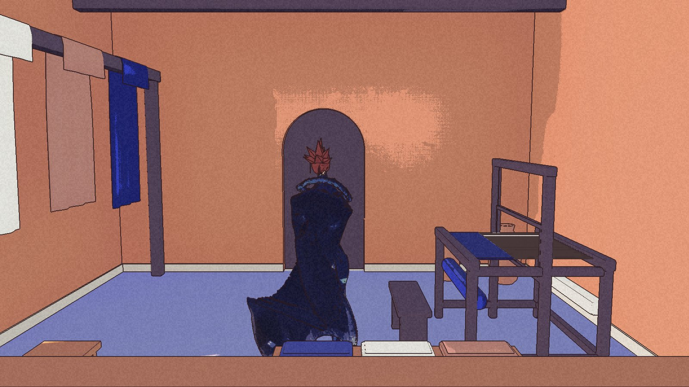

The settlement has a name now. **Keepers’ Cove**, from Nic on 30 October. The people still have placeholders. The place got there first.

The name is in the project data. It is not yet in the packaged area picker: the latest internal build, par10, was made on 29 October and still carries the old label.

**Par10 built, packaged and launched cleanly. Nic has not played it**, according to the latest coordinator report. An earlier entry said he was playing; the newer note corrects that. The [public download](/download/) remains Demo 0.1.0.

## Cloth inside the door

The household has a loom, shelves with pots and folded cloth, a work table, stools and washing hung across the room. Thirteen pieces were added. The hall was furnished first. This room has smaller work to do.

Its interior setting is lighter than the hall’s. The packaged check enters the household and records the setting chosen for that door. The reviewer sees a warmer, lighter room too. The camera still takes time to settle its brightness after entering.

The pale patch around the arch remains. Facing back toward the door, the table hides Kai’s feet. A shorter camera boom was tried in review and left out: it did not improve both directions. The room is furnished, not finished.

Both pictures here come from the par10 packaged household check.

## Smaller joins

Outside, the path pieces have been reduced from eighteen to twelve. Shorter overlaps replace the broader joins, and the tapered end pieces are gone. Their material has not changed.

The reviewer sees a softer seam under the gate at a close zoom. From the ridge at normal size, par9 and par10 are almost indistinguishable. The path darkness still needs Nic’s eye.

## Checks that count

Continue passed at all three saved positions. The route walk, jetty check and both interior checks passed. The six fixed comparison frames passed too, with the reviewer reproducing the results.

The previous post recorded a comparison checker that could announce success without reading its results. Par10 read all six. After review, the next-window checker was tightened further to reject missing or repeated shot names and failed comparisons. The river-motion check now rejects missing frames and an undersized water sample. Its par10 rerun confirms movement; it does not measure the whole river.

Frame time was skipped because the machine was busy. There is no new quiet performance result. Nic’s calls on path darkness, the room’s brightness settling and the lamp remain open. The name is settled. The look is still waiting.
