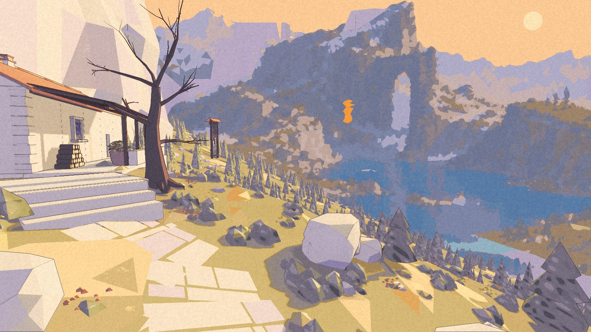
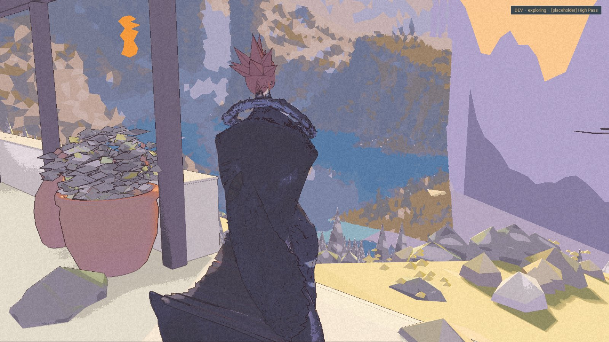

There are flowers beside the stair. They look softer from here than from the terrace.

Par13 is built and packaged. Its launch, route, interior and picker checks passed. **Nic has not played par11–par13.** This is the next internal look, not an accepted one. The [public demo](/download/) remains 0.1.0.

## The bank and the edge

The flowers make a gold and orange bank along the stair and switchback. In the wider terrace view they are quieter, small rust-coloured shapes between the rocks. The reviewer would keep the density. Nic’s eye still decides.

Two revised surfaces change the cliff edge and the lake’s meeting with the headland. The first report called the lavender wedge gone. The review corrected it: **reduced, not gone**. A hard band remains above the fir at the lower right.

Lavender panels still stand beside the refuge. The lake and mountain break into hard facets, and the orange seam in the arch remains the strongest colour. The chime structure was already there; it is not a new addition in this build.

## Facing the lake

The arrival turns Kai toward the lake. This time the packaged picker check proves the new direction, rather than a review camera placed at the same spot. The arch clears his head. The flat lavender wall on the right is still part of the view.

All three pictures here are from the par13 package. They do not replace a hand walk of the region.

## What the distant views can say

The new scenery checks compare fixed town and desert views. The reviewer also ran them with the High Pass left out, and with its distant pieces allowed to draw much farther away. The normal town views stayed clear; the deliberately extended scenery appeared and the check caught it.

These checks ran in the editor’s game mode, not the package. The desert sky dome hides the peaks even when they are being drawn, so a clean desert picture cannot prove that the peaks cost nothing.

The earlier small changes in comparison frames now track whether the High Pass is built. Why that changes scattered pixels is still unknown. The results remain below the pass limit.

The packaged Continue, ford-weather, place-card and picker checks passed again. Frame time was skipped under load. The flowers add geometry, but the record has no quiet measurement of its cost yet. The bank is fuller. The unanswered number stays blank.
