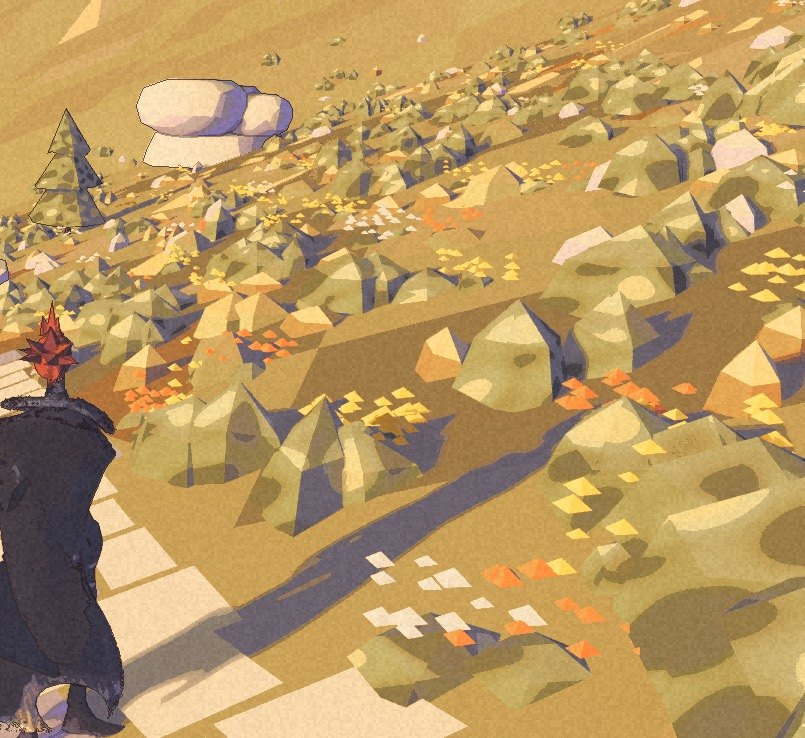

> 1 November: par14 is packaged, and Nic says the new flowers can stay for now. See [the next record](/updates/2026-11-01-the-flowers-can-stay/) for the changes and remaining limits.

The door passed its check. From another camera, the cliff was in the way.

Nic has now played par13. That changes the acceptance note in [this morning’s record](/updates/2026-10-31-flowers-beside-the-stair/). The build is packaged and checked, and it has been walked by its maker. The High Pass is not accepted as finished.

## Keep the direction

The lake-facing arrival stays. So does the slow downward change in exposure after entering a room. Nic likes that settling of the light.

The lavender scenery beside the arrival is less settled. Nic calls it cardboard. From his camera it blocks the refuge hut’s door. A clean door check did not settle how the approach reads when someone chooses their own view. The requested correction is clear: give the rock form, cut it back where needed, and leave the door readable and reachable.

## Keep the bank, change the flowers

Nic agrees with the wider view: the flowers look like chips. The near-bank density stays. The shapes need a different approach, small yellow flowers that read like the painting.

The lake vista is a good start, in his words, but hard to read. The lake, mountain forms and amber seam still need attention. The earlier package pictures remain part of the record. These two pictures add the view from his playtest. Neither shows a correction completed.

## The town has another note

During a long session, Havenwood looked flat and textureless around the church and Street 1. A restart helped. The logs were clean, and the cause is not established. The next comparison needs the textured street reference and a close look at the church square. A screenshot can show the symptom. It cannot name the fault.

The [roadmap](/roadmap/) carries the requested work. No newer build is published here today. The [public demo](/download/) remains 0.1.0. Performance is still unmeasured. The view has had a visitor; the unanswered number stays blank.
