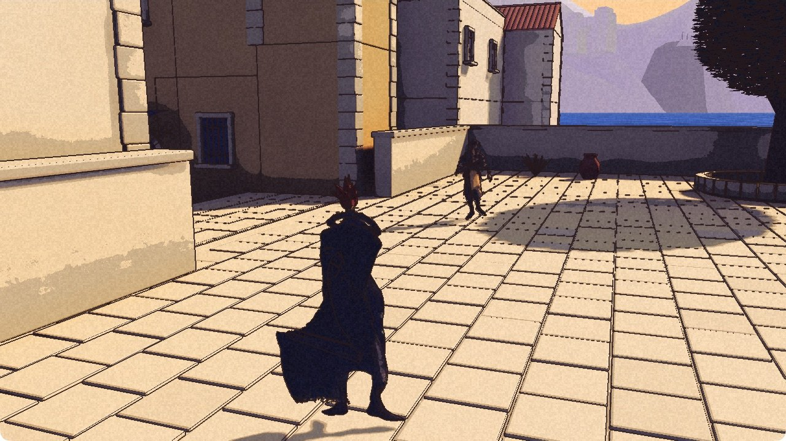
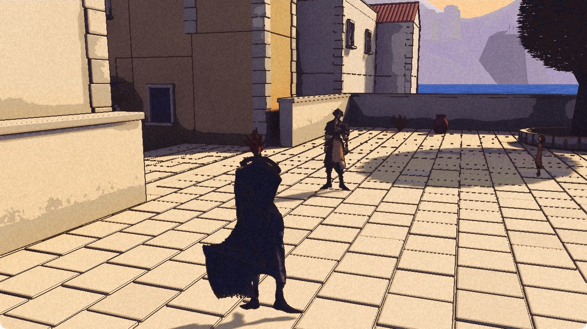

There is someone else beside Kai. He has sleeves, boots and somewhere to stand.

Rex is in the par15 Development package. It launches and exits cleanly. An independent review accepts a bounded checkpoint for Nic to test: normal loading and spawn, ordinary walking, a diagnostic catch-up and a settle. This is not full companion acceptance, finished art or a public release. The [demo](/download/) is still 0.1.0.

The opening picture comes from normal startup. Rex is the shorter figure in the pale apron and layered sleeves. Kai keeps the red hair and long cape. The courtyard has not mistaken one for the other.

## A short approach

The next two frames are from a diagnostic check. Kai was relocated to create a gap, and Rex came towards him.

That relocation put Kai into Ghost mode, with collision disabled. It is not proof that the pair can pass through an ordinary door, climb stairs or cross a slope together.

The log records Rex walking before the relocation, moving faster during the approach, then walking and settling later. His own sampled movement records report him grounded. The selected frames support a visible approach without an obvious large jump or float. They do not measure every foot contact or prove a complete run cycle. The later walk and settle are outside this short capture; these pictures are not a continuous film of that transition.

## Not quite dressed for the whole journey

The apron and sleeves distinguish him from the earlier blue figure. His upper clothing, face and device still read dark and coarse in these views, and his arms sit away from his sides. Close art, hands, feet, turning and animation transitions need their own checks. Performance is unmeasured.

Ordinary doors, stairs and slopes, recovery after leaving view, and battle entry and return remain open before full companion acceptance. Nic has a Development checkpoint to play. The record has a person crossing a courtyard. For today, those are the claims.

The [characters page](/characters/#rex) keeps Rex separate from the fifteen town residents. The [roadmap](/roadmap/) keeps the remaining work separate from this checkpoint.
