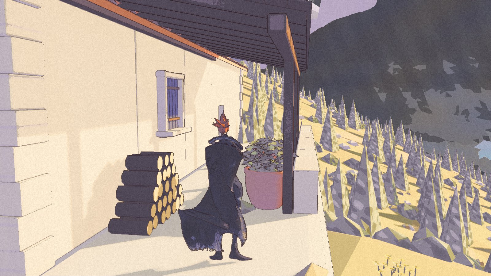
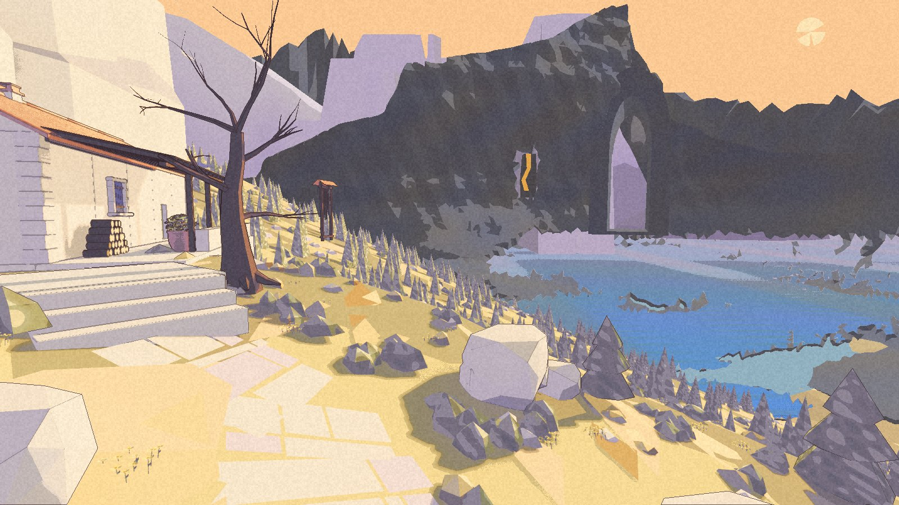
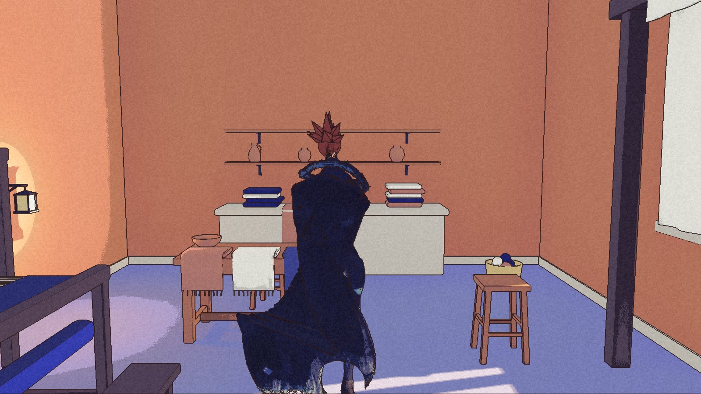
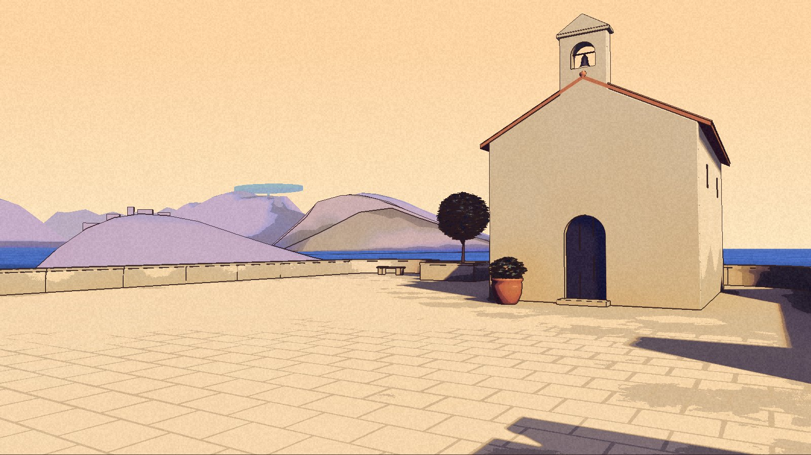

The flowers have stopped being chips. They can stay for now.

Par14 is built and packaged for local Development playtesting. Its clean launches and exits, route and interior checks, and independent review are recorded. The handoff includes an explicit timing exception. It is not an all-tests-green build or a new public release. The [public demo](/download/) remains 0.1.0.

Nic has played it. His latest note keeps the small yellow flowers unchanged. It does not accept the whole pass.

## A door, and the view beyond it

The refuge approach is clearer. A continuous packaged check walks to the door, enters, leaves and returns. The arrival direction and the slow indoor exposure settle stay as Nic chose them.

The lake is blue water now, with a moving pattern. A separate review of the actual package frames supports that motion. The original timestamp-based test still failed because the required capture timestamps were missing. That result has not been painted green.

The rocks have gained form, but the broad dark faces remain. The amber seam reads as a graphic mark rather than light. The water keeps regular scalloped edges. In Nic’s own views, nearby trees and walls still obstruct the vista, and there is little walkable descent. A better terrace picture does not settle what the whole route feels like.

The density stayed. The heads and stems changed. This is the part Nic has asked to leave alone.

## A small pool of light

The household lantern casts a local warm pool. Matched on/off views show it without changing the room’s overall exposure settle. The selected Cove path treatment is also in this package.

Town surfaces have more detail. The original textured street core held through the package checks and a bounded return test, including three minutes standing still and visits elsewhere. The chapel’s upper face remains quiet. This does not establish a cure for the earlier long-session flattening or black sky.

## The desert moves, with a qualification

After forty to seventy seconds of eligible quiet play, the desert sends three crest-dust pulses with subtle camera movement. Reduce motion suppresses the camera movement while keeping the dust. Separate package checks show the visible effect, the setting surviving relaunch, and clean exits.

One instrumented test at 1280 by 720 recorded a pulse gap of 1.140 seconds against a 1.135-second limit. It remains failed. A timing and menu test passed at 960 by 540; that did not repair the larger-resolution result. The Development review accepted this disclosed exception, not a universal timing guarantee.

Nic later reported missing shake and unresponsive mouse input. The current log contains desert dust pulses after Reduce motion was turned off, but does not establish what his camera displayed. Keyboard checks cannot close the mouse report. Some cancellation contexts still have only code/API coverage, rather than a physical playtest.

All five pictures here are from the reviewed par14 package. Distant-scenery checks used a bounded measuring protocol; instability with the normal renderer remains unexplained. Quiet performance is unmeasured. The [roadmap](/roadmap/) keeps the next work separate. The flowers can stay. The rest of the view is still being asked.
