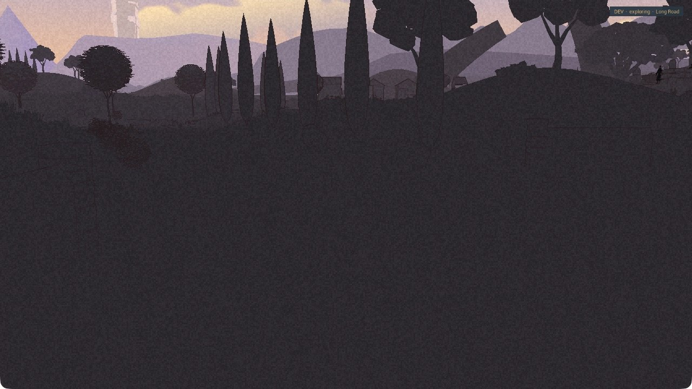
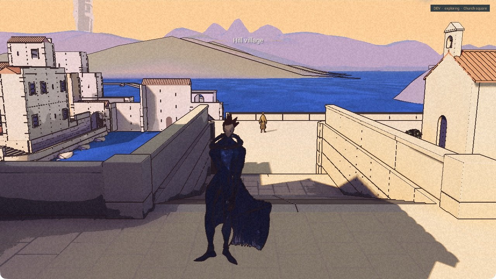

This time, both wake on the road.

The new Game22 Development package builds, launches and exits cleanly. In its optional Development battle mode, an actual defeat brought Kai and Rex back to the wake point together. The final return completed, control came back to Kai, and Rex resumed following on flat ground.

Independent review passes that bounded behavior. It closes the earlier case where placement happened but the final wake check aborted. It does not turn the whole companion green. The [public demo](/download/) remains 0.1.0.

## The part the picture cannot settle

The game’s records say the placement and final hold occurred under full blackout. This capture is dark, but the world is still visible. Its request time does not identify the exact rendered frame it caught.

That is a gap in the evidence. It proves neither that the relocation was hidden nor that the player saw it happen. The visual check stays open. A later short-transition capture trial also failed to cover the needed interval. The next recording must show the whole transition before a longer wake test can answer that question.

The opening picture is later, with the pair back on the road. Subsequent position samples and movement records support Rex approaching and stopping on flat ground. They do not establish every foot contact, a complete animation cycle or unrestricted following.

## The stairs do not agree

Kai reached the upper level. Rex remained below. The town stair check still fails; the slope check is only partial. A clean exit and restored save do not change those results.

The High Pass check also stopped early. Kai walked the approach and part of the first descending step while Rex stayed near the arrival point. On the way back, Rex moved and they reunited. The full descent, climb back and refuge-door route were not completed.

## One menu choice, correctly recorded

Nic chose a small diagnostic build to investigate the input trouble. One short check now records the highlighted area, the key event, the requested destination and the actual arrival agreeing. That is one successful observation, not a general input repair or a physical-mouse test. The cause of the earlier failures remains open.

The earlier door, victory and escape evidence still stands at its own scope. Nic’s overall-look verdict also stands: Rex looks okay, but his face is hard to read. There is no new face acceptance here. Performance is unmeasured.

The [roadmap](/roadmap/) keeps the remaining routes and visual checks open. Both are back on the road. They still have to get up the stairs.
