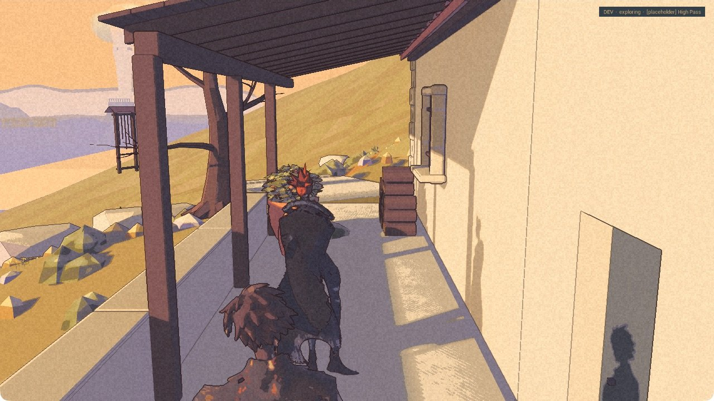
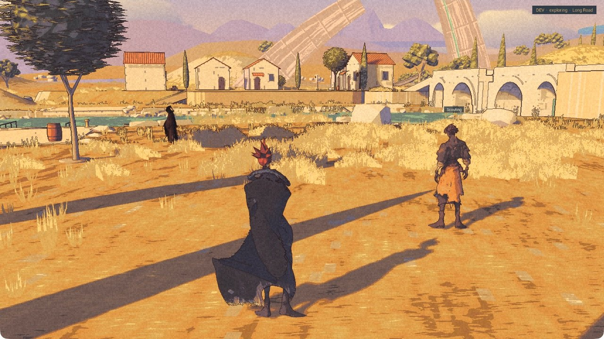

Rex comes back through a door. After a battle, he starts following again. These are small things to ask of a companion. They have each needed checking.

The earlier par15 A2 package now has independent review of refuge entry and exit, and of two encounters in the optional Development battle mode. The latest A4-v21-a2 package has separate clean launch and exit checks. Neither is a new public release. The [demo](/download/) remains 0.1.0.

Nic has seen Rex. His overall look is okay, but his face is hard to read. That is a visual verdict with a specific gap, not acceptance of the whole companion.

## Through the dark, back onto the porch

The A2 check used the actual refuge prompts and door fades. Rex rejoined Kai while the screen was fully black. This was ordinary travel, without the Ghost relocation used in the first courtyard catch-up check.

The same package still failed the town stairs. Kai reached the upper level while Rex stayed below; later recovery did not make that a successful walk. The High Pass arrival also produced an obstructed view. Walking and returning through the door cleared the view, but the cause was not established.

A separate controlled camera test supported a narrow recovery rule: defer relocation while either the old or proposed position intersects the camera view; permit it when both are outside. That does not prove every recovery or smooth movement on every frame.

## After the encounter

One victory and one escape returned control to Kai. The log then recorded Rex following on the ground again. Independent review accepts that small sequence. It does not accept battle staging: formation placement and framing were incomplete, and the pictures do not prove finished companion attacks.

Defeat is a separate result. In A2, Rex was left far from the wake point. In A3, both figures reached the wake area, but the final return check still failed. Being nearby was not enough to call it fixed. Complete defeat return remains open on the newer package.

## A face, and a route still to finish

The opening frame is from A4-v21-a2 at the church terrace. That later session was interrupted and the saved state restored; it was not a clean exit or a passed route. Other sessions on the same package supply the clean launch and exit evidence.

Nic’s short physical keyboard/menu check passed. Automated control remained unreliable, so the later attempts do not settle ordinary stairs, slopes or the complete High Pass descent and return. The cause of the control trouble is unknown. It is not proof of a new game-input defect, nor proof that mouse behavior is fixed.

The overall figure can stay for now. His face still needs to read. Full companion acceptance, camera usability, the longer route checks and performance remain open. The [roadmap](/roadmap/) keeps the unfinished work there, where the record can find it again.
