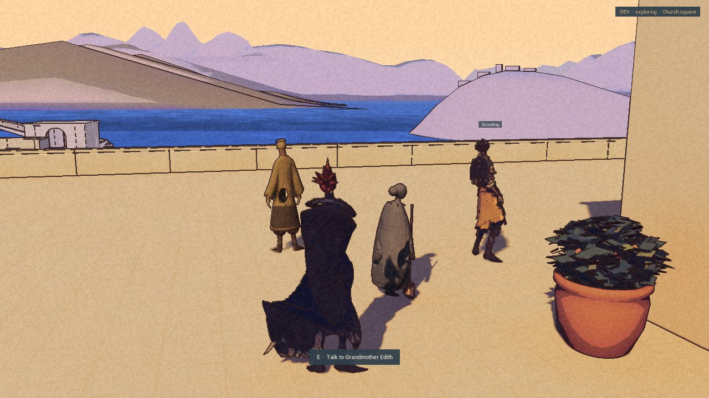

Kai has a sword. Edith has a broom. Both have something to do with them.

Par16 B2 is built and packaged. Two game sessions launched and exited normally, with the test save and settings restored afterward. Independent review accepts a bounded early checkpoint: keyboard battles and a small preview of life in town. Full battle and resident routines remain unfinished. This is an internal Development build; the [public demo](/download/) stays at 0.1.0.

## The sword moves

Kai now has sword-ready, slash, low guard and hit actions. The new battle motions leave his shared walking skeleton and locomotion in place.

The opening frame comes from B1. That run recorded a fifteen-turn victory and returned to exploration. B2 keeps the same battle code and data, then separately checks Escape and a defeat after thirty-nine turns of defending. Kai returned to exploration, Rex rejoined, and movement resumed.

That is the mechanical return. The defeat animation is still a short stagger and fade. A full collapse is unfinished, and the batched input missed the visible fall and fade interval. There is no new proof that relocation stays hidden.

Arrows and Enter are the verified controls. Mouse commands remain unaccepted. The sword’s contact timing and the low guard still need visual polish.

## The broom moves too

Edith has moved onto the church terrace for this preview. Her small strokes now carry the broom with her hand. Talking interrupts the activity; leaving lets it resume. With Reduce motion on, she stands quietly with the broom. Tom’s short ordinary walk was also observed.

The dust really does fade in the material during a sweep. The picture is less convincing: the difference is faint and mostly covered by Edith’s cloak. Clear visible cleaning is not accepted yet. Her fingers and the bristles’ contact with the paving also need work.

The bell’s audio component starts in the records, but there is no listening check. Silas’s ringing-arm animation remains unfinished. These are the same residents, with the first few activities; the wider daily routines are still to come.

## Where the previous work rests

Par15 closed on its accepted v21-a2 predecessor. Later diagnostic builds and their failed checks remain in the record. Rex body and face work are parked, and this battle slice adds no combat kit for him. The new work does not close the old stairs, High Pass or performance questions.

The [roadmap](/roadmap/) keeps the remaining work visible. A clearer fall, reliable mouse commands, and dust you can actually see being swept away. The town has a little more motion. It is still learning what the motion should mean.
