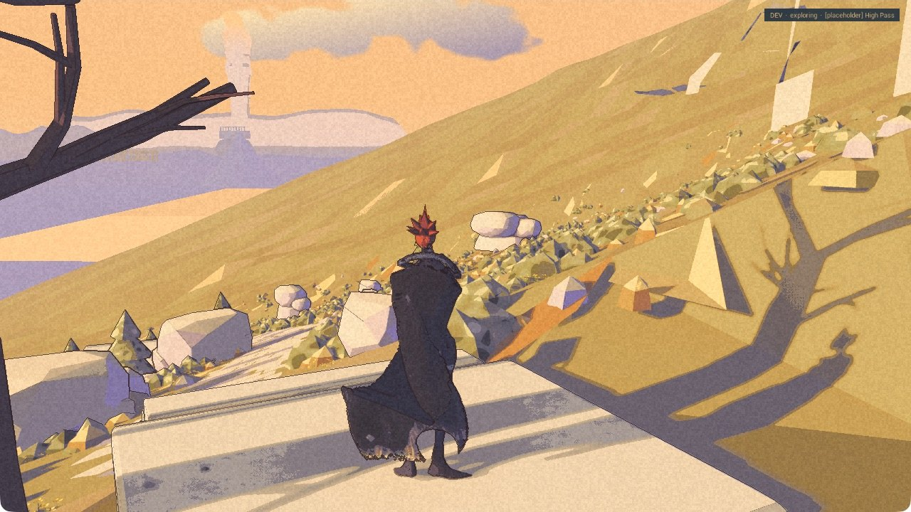

The first step is still a step.

Game23 is built and packaged for internal Development checks. Its first launch crashed before reaching the title. Later launches reached the title and closed normally, including an independently reviewed short High Pass pilot. That is a clean later check, not proof that the startup fault is fixed. Nic has not accepted the full companion. The [public demo](/download/) remains 0.1.0.

## A short distance, more carefully recorded

The area menu selected High Pass and arrived there correctly in this run. Rex stayed at arrival through the first two position samples, then moved towards Kai. The later samples showed no further progress. He was not motionless for the whole check. He did not complete the route either.

The opening picture looks back towards the refuge after that movement. These stills and separated position reads cannot show a continuous descent, every foot contact or the climb back. Independent review accepts the short diagnostic collection and safe closure. The full route stays open.

The town check is less ambiguous: Kai reached the upper level and Rex remained below. Returning to the lower ground brought them together again. That recovery does not pass the stairs.

## The dark interval is still missing

The [earlier defeat and wake check](/updates/2026-11-02-both-wake-on-the-road/) still supports its bounded mechanical result: both return, control resumes and Rex follows on flat ground.

Two new recording setups failed to produce a qualified recording. Neither closes the question of whether relocation stays hidden. A clean game exit does not make a missing recording useful.

The earlier startup and town runs also needed restoration work before their checks could close. That work was reviewed as complete; their failed results remain failed. The later High Pass pilot closed cleanly without that recovery.

Nic’s verdict on Rex’s look is unchanged: okay overall, face hard to read. There is no new face acceptance. Performance is unmeasured.

The [roadmap](/roadmap/) keeps the remaining routes and visual checks open. There is a clearer record of the stopping place. The stairs have not moved.
