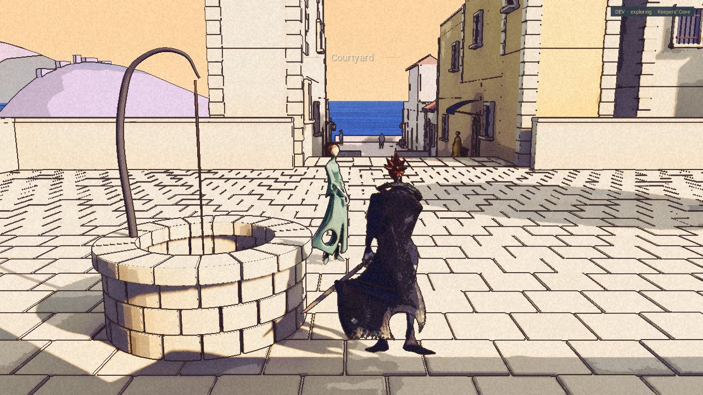
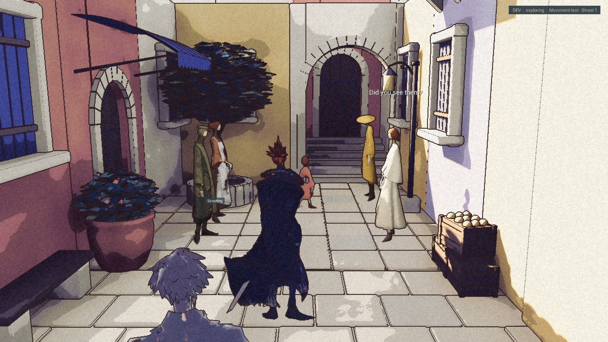
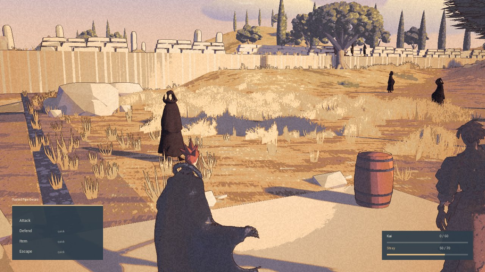
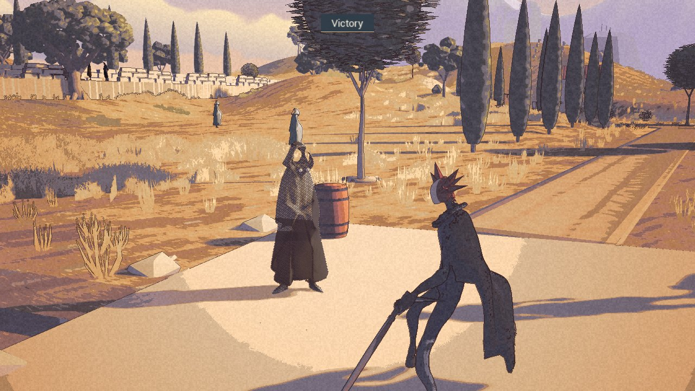

“Mind your cuffs.”

The Woman at the well has an evening line now. In the internal B5 package, she supports a piece of ivory cloth in the Cove household and makes a small mending motion beside the lantern.

This is the same Woman. Between 18:00 and 22:00 on the game clock, she changes location only when both ends are out of view and clear of interaction. There is no walked commute. Watching the destination keeps the move pending; looking away lets it happen.

Approaching or talking holds her work pose. Leaving lets the work resume. Pause and Reduce motion were checked separately. The ordinary household door and its selected exposure settle worked in the packaged check. The close dialogue view can still disappear behind Kai; the wider work view is readable.

At the end of the evening, the return waits for concealment too. She was back at the well afterward. Cuffs intersect, fingers stay stylized and the cloth is rigid. This is a reviewed small routine, not a finished simulation of a town.

## Other people have things to say

B3 brought Tom and Anna into a street exchange. The Child walks and pauses between Rowan and Aldric. The captions and exchange cycle were captured; approach, dialogue and pause quiet the conversation before it resumes. B4 retains that preview. No goods transfer or complete route audit is claimed.

## A lower defeat, a disappearing enemy

B3 replaces the earlier short stagger with a held kneel. Normal-speed playback and a separate Enter skip both returned Kai and Rex successfully. The game view hides the lower legs behind the cape; it cannot prove continuous contact. Slowed inspection failures remain failed checks.

B4 packages the enemy body, eyes and walking animation that were missing from B3. The specific reload check passed with those resources present. A keyboard victory also checked guard, a Tonic, visible dissolution, disappearance and return to exploration. The earlier crash stays in the record; this is a bounded replay result, not a general reliability guarantee.

B5 retains that battle work and adds the mending routine. All three packages have reviewed limits and clean later game exits. B5 is accepted as a limited Development successor, ready for Nic to test. The [public demo](/download/) remains 0.1.0.

Physical mouse control is still unproved. The automated traces do not establish a hardware or coordinate diagnosis. Edith’s cleaning remains too faint, wider resident routines are unfinished, and performance is unmeasured. Rex work stays parked.

The [roadmap](/roadmap/) carries those limits. For now, someone has found a little work to do before returning to the well.
