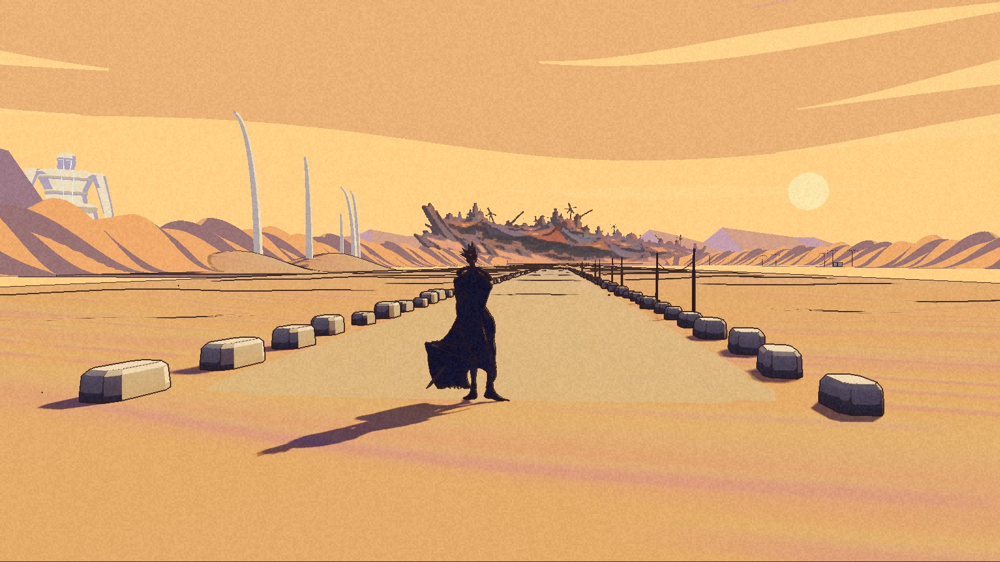
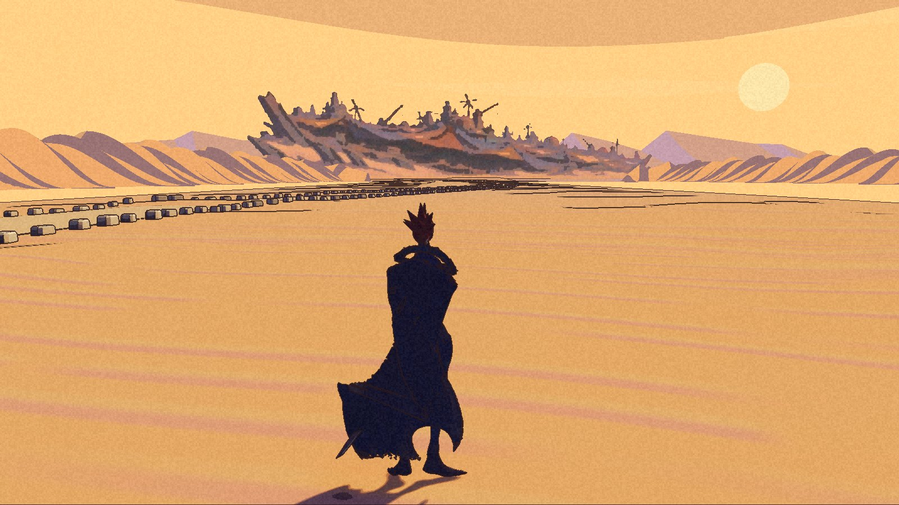

There is a city ahead. At this distance, a painting is enough to keep it there.

The first Salt Road checkpoint is packaged: about 1.2 kilometres of desert corridor, with border stones, rope guide-poles, pale ribs and a dark skyline at the end. Nic’s verdict on 5 November was “looks good for now,” followed by “continue.”

This is an internal Development build. The [public demo](/download/) is still 0.1.0. For now, the development picker is the only way onto the Salt Road; there is no walking link from the Opening Desert.

## Kesler Pi

Nic named the larger city Kesler Pi. It is separate from Zephyr, the smaller mobile refuge convoy. The selected city is a dark, patched mass buried in sand. No wheels, treads, legs or dust wake announce it.

At this checkpoint, that mass is a painted skyline card. It has no moving parts and no playable interior. The High Pass look-back and the city’s wider world-marker position remain parked.

## What the walk proves

The packaged walk reached sixteen targets, westward and back east, without a sea catch or fall. It followed a straight corridor. Some frames put Kai beside the bordered trail, so this is not proof of freely steering along every bend or edge. No human walk of the packaged trail is recorded.

The first packaged picker check was wrong: its view appeared before the selection, and it never proved travel through the menu. A separate corrected check used the menu keys without the review mode that disables them. It recorded both the Salt Road travel and arrival after Enter, with no save written. That closes the picker finding; it does not erase the first failed proof.

The retained package checks exited successfully and report the original save and settings unchanged. These are the recorded checks, not a fresh game session for this post.

## The road has too many lines

The reviewer found hard ground outlines and rectangular bands competing with the road and skyline. The ribs read as thin spikes instead of broad arches. The oasis is weak from Kai’s eye, and the straight approach lacks the painting’s winding depth.

Those gaps remain visible in these checkpoint-1 frames. The warm ochre, lavender and darker city are there; the composition is not finished.

The fixed comparison checks passed within their stated bounds. One battle-tooltip rectangle was masked, and the town comparison used a baseline taken after re-importing the old map. Seven gameplay suites passed. The existing barter checks and six Dyers step routes remained failed against their matching earlier baseline. This was not an all-green test suite, and no new performance result is claimed.

This post records checkpoint 1. Later work and its frames wait for their own gate. The [world page](/world/#salt-road-trail) now records the accepted first checkpoint, and the [roadmap](/roadmap/) keeps the unfinished work beside it.

The city can stay at the end of the road for now. The road still needs to learn the painting.
