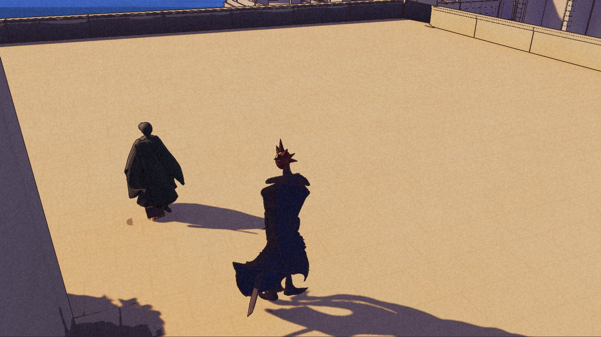
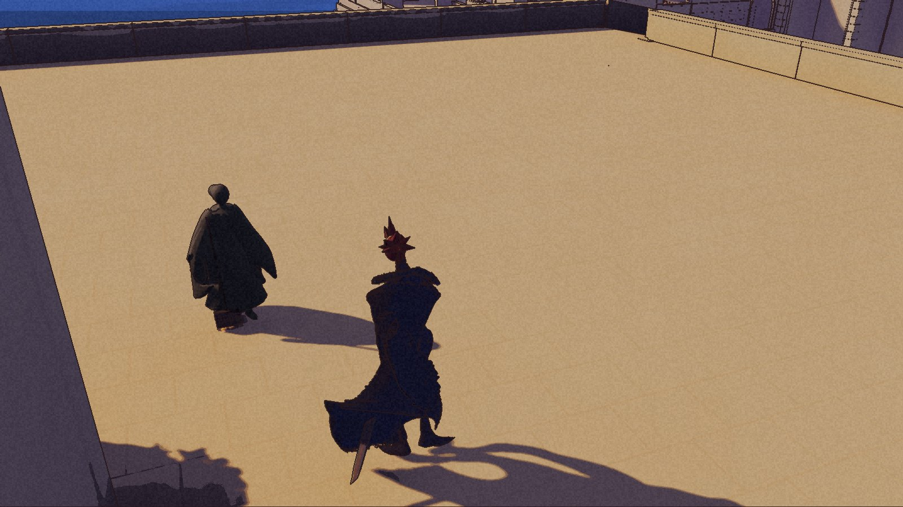
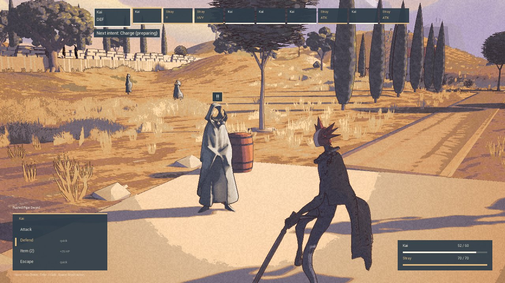

“One thing at a time.”

The Old Man says it from the church square bench now. In B7, the same resident sits with his cane and feet supported. Repair and move the cart through its ordinary interaction, then return, and he has noticed: “The cart has rolled clear, then.”

These are small changes from the three internal checkpoints reviewed on 4 November. Nic has closed par16 with B8 as its reviewed Development checkpoint. The round is closed; the remaining town routines are not finished. The [public demo](/download/) is still 0.1.0.

## A little less dirt

B6 gives Edith a small dirt patch that visibly clears beneath her broom. Supported strokes remove the film in ten increments. Pause holds that progress. Reduce motion shows a quiet clear patch without granting cleaning progress; ordinary sweeping resumes with the film that remains.

The pair shows remaining dirt and the completed patch, not a full dirty-to-clean sequence. Physical bristle contact and a clean whole square are not claimed.

Four existing street windows also gain shutters, open by day and closed at dusk. Only the leaves move. The old frames stay where they were. Next-day behavior still needs its own check.

## Things carried, things left

Old Reed carries a small net sling along his short route on the Cove jetty. It stayed with him through walking, turns, nearby conversation and resumed walking. His body and walking clips are the existing ones. The relaxed fingers and known contact crossings remain prototype limits; the longer proposed route is not in this build.

Father Silas has a quiet hand and forearm gesture at the bell, inside the chapel. Natural tolls, return to idle, pause during a pull and cancellation with Reduce motion passed. This does not establish a hand gripping a rope. Rex has a restrained upper-body response to natural desert tremors, returning to neutral afterward. That is presentation only. His body, face and following work stay parked.

There is an anonymous logbook on the High Pass refuge table. E reads it:

> I rested here for the night. Leave room for the next traveller.

No item, flag or quest is awarded. Reading and leaving were checked separately, with assisted approaches among the evidence. They do not prove an unassisted route through the whole room. The Well Woman’s evening mending remains from B5.

## The next blow has a name

B7 makes the Item count and its +25HP effect visible. B8 gives the enemy’s next-intent line a dark panel, pale text and a little more room. The preparation says “Charge (preparing)”. The following attack says “Heavy Strike -> Kai”.

The clean final replay checked the actual sequence: Charge did no damage, the guarded Heavy Strike did eleven. An Item healed nineteen, from forty-one to the sixty-point cap, and its count fell from two to one. Escape returned to exploration and the game quit normally. The battle rules did not change.

The earlier faint-text failure remains a failure. So does the replay with uncertain control ownership. Neither is used as the successful check.

## What the checks cover

B6, B7 and B8 passed review as limited Development checkpoints. The pictured B6 session had a launch-isolation failure and required restoration of affected save and settings files. Its original pictures remain valid visual evidence; its exit is not called clean. A separate B6 replay read the book and quit normally with the originals unchanged. The main B7 session ended at its watchdog, not through a normal menu quit; a later short replay supplied that check. The fresh B8 replay also quit normally with the originals unchanged.

The bench and jetty approach checks accept the player corridors actually travelled, with camera assistance and failed attempts retained. They do not accept general navigation or complete body and net clearance. Physical mouse control and performance remain unproved.

Wider Old Man acknowledgements and the longer Reed route are staged work, absent from B8. The next round must scope and check them. Nic still owns the pending mouse check and the Flora canon decision. The [roadmap](/roadmap/) keeps the unfinished work visible.

For now, there is less dirt under one broom. There is still room for the next traveller.
