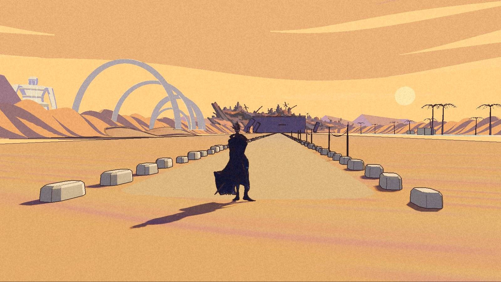
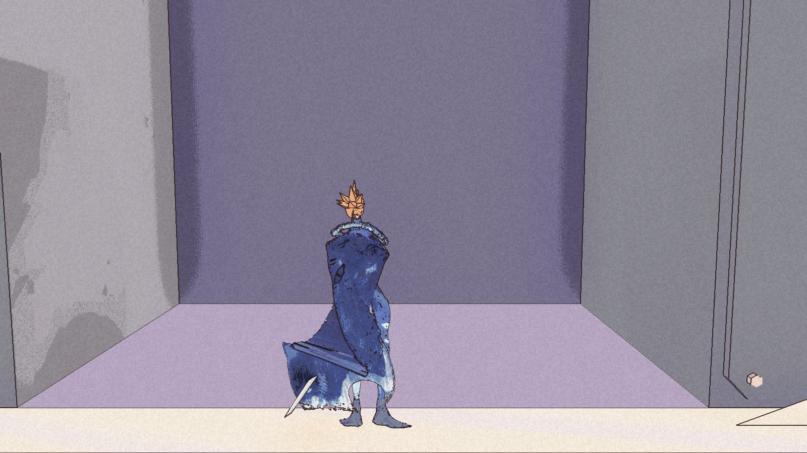
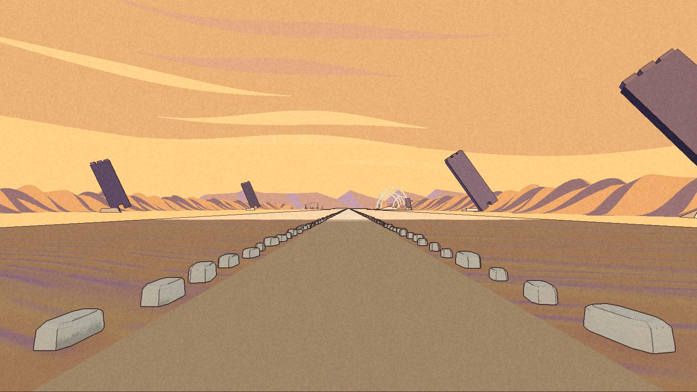

The city has a wall now. The road stops at it.

Salt Road checkpoint 2 is built and packaged. The reviewer passed the private playable exterior with findings. On 6 November, Nic put acceptance on hold until he walks the build. That is the current state: packaged and checked within limits, not yet accepted by Nic.

The [public demo](/download/) remains 0.1.0.

## Closer to the wall

Five buried spurs stand along the approach. At the far end, the hull wall fills the view. The “Kesler Pi threshold” marker is reached by walking; it is not a separate picker destination. The opening blocks passage. There is no playable interior behind it.

The ground has also changed since [checkpoint 1](/updates/2026-11-05-a-city-at-the-end-of-the-salt-road/). Broad arches replace the thin ribs, the repeated hard corridor outlines are gone, and the oasis palms and wall are easier to identify. Pink bands remain. The road is still straight where the painting winds, the water is weak in the view, and a strong ground crease survives in the far camera.

## The opening lets in too much light

From twenty metres, the opening reads dark with a pale patch inside. At the stopping point it becomes a lit lilac alcove. The blocker holding Kai back does not make that a finished painting match.

Landscape and the coordinator need the cap and recess to stay dark from both distances. That work waits for Nic’s walk and his decision on the remaining findings.

The selected forward review camera shows only one spur. Looking back from the threshold shows four. This confirms the field is there; it does not prove the intended composition of skyline and spurs. The regular wall and flat surfaces also remain departures from the selected painting. Settlement and the coordinator still need a more useful review view.

## What passed, and how

The packaged keyboard check entered Salt Road through the picker, then returned to the courtyard. It wrote no save while exploring. The one exit save came after the return, in the private test folder. All three package checks exited successfully and report the original save and settings unchanged, with no restoration.

The automated walk reached sixteen targets out and back without a sea catch or fall. A twenty-second push at the centre of the opening stopped short of the blocking plane. A separate seeded movement check stayed grounded. Those are bounded results: no human trail walk is retained, and they do not establish every side approach or possible way around the blocker.

The first automated chain did not pass end to end. Its package checks and gate wiring had failures. Separate reruns supplied the retained evidence, and the corrected threshold, picker and walk checks were independently re-evaluated against it. The reviewer accepted that recovered evidence; the failed runs remain failed.

The fixed comparison and distant-view checks passed within their existing masks and baselines. The earlier barter and Dyers step failures stay parked. There is no new performance claim.

Nic approved committing the checkpoint and copying its comparison boards into the project record. His play acceptance remains separate and on hold. The [world page](/world/#salt-road-trail) and [roadmap](/roadmap/) carry that distinction.

For now, Kai can reach the wall. The darkness behind it still needs work.
