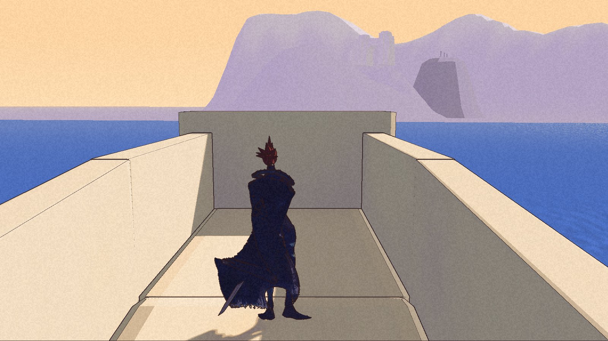
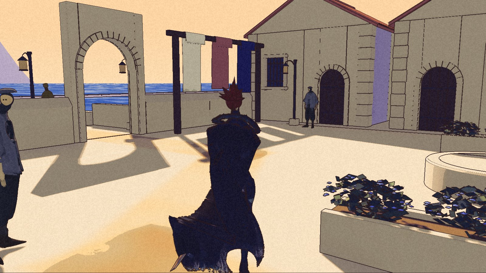

The road leaves Keepers’ Cove. Its name does not know where to stop.

The first leg toward High Pass was built, packaged and walked in private checks on 7 November. Run 8 completed clean launches, the full recorded walk and its boundary tests. Then the coordinator found that its place boundary also covered Havenwood. Standing in town could be recorded as standing on “High Pass road 1”.

**The package was not accepted. The coordinator withdrew it and restored the previous project state.** These are frames from that retained experiment, not a new playable release. The [public demo](/download/) remains 0.1.0.

## One leg, with an end

The candidate opens an exit behind the Cove hall and adds about 1.75 kilometres of contained road, climbing about 175 metres. It is the first leg only. It does not reach the accepted [High Pass terrace](/updates/2026-11-07-the-way-back-holds/).

The pilot reached twenty-two targets. The full walk reached all seventy-six, from the Cove to the road and back. All nine files of boundary pushes passed the run’s checks.

One downhill push lost about 1.61 metres of height while sliding along the road’s grade. The revised check required every recorded frame to remain on the tread, rather than treating height loss alone as a fall. That is a bounded diagnostic result, not proof against every jump or side approach.

The road still reads as a long bare corridor. Earlier ridge and hall views also showed a pale slab with a dark underside. The art review leaves that bank shape unfinished; walking through the candidate does not accept its appearance.

## A successful walk missed a larger mistake

The circle used to recognise the road was too broad. It included the courtyard and town start. A private test save made there wrote the road’s place name. The walk and picker checks had passed without catching that overlap.

The original save and settings stayed unchanged in the guarded package checks. That protection does not make the candidate’s place labels correct. The coordinator restored the previous map, sources and staged data, and kept the failed package as evidence.

Earlier attempts also had gate mistakes, interrupted or timed-out checks, and repeated crashes before the packaged game reached its map. A later successful launch does not erase those failures. Run 8’s distant-view check needed a repeat after a foreground shadow changed; the repeated comparison passed. The changed ridge view remains an art finding.

## What must pass next

The replacement needs a road boundary that excludes the town, a single picker entry and correct arrival, return and save-place behavior. It must retain the continuous road and boundary checks. That replacement is still under test, with no new accepted checkpoint to show here.

The [roadmap](/roadmap/) keeps the first leg in progress. The town keeps its own name for now.
