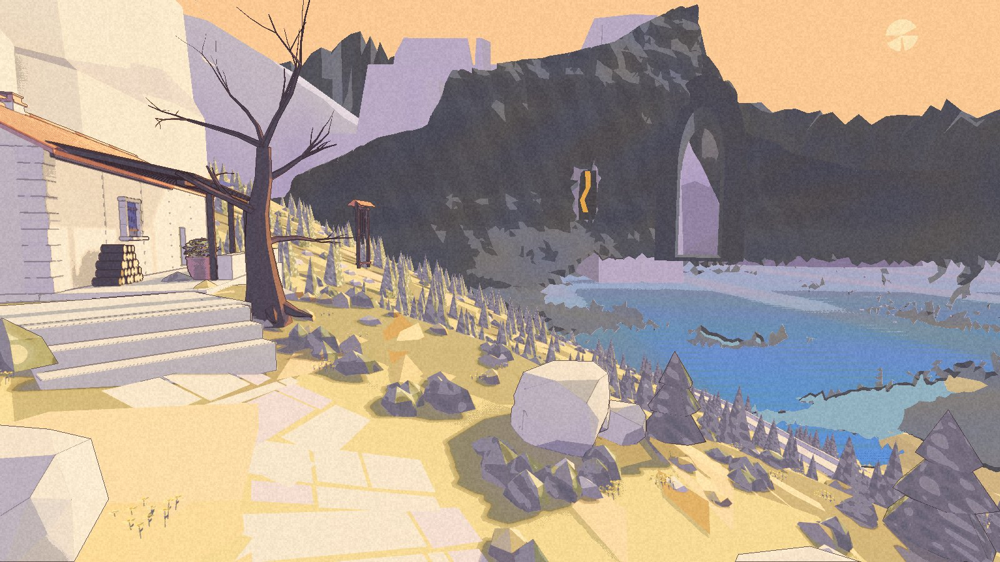
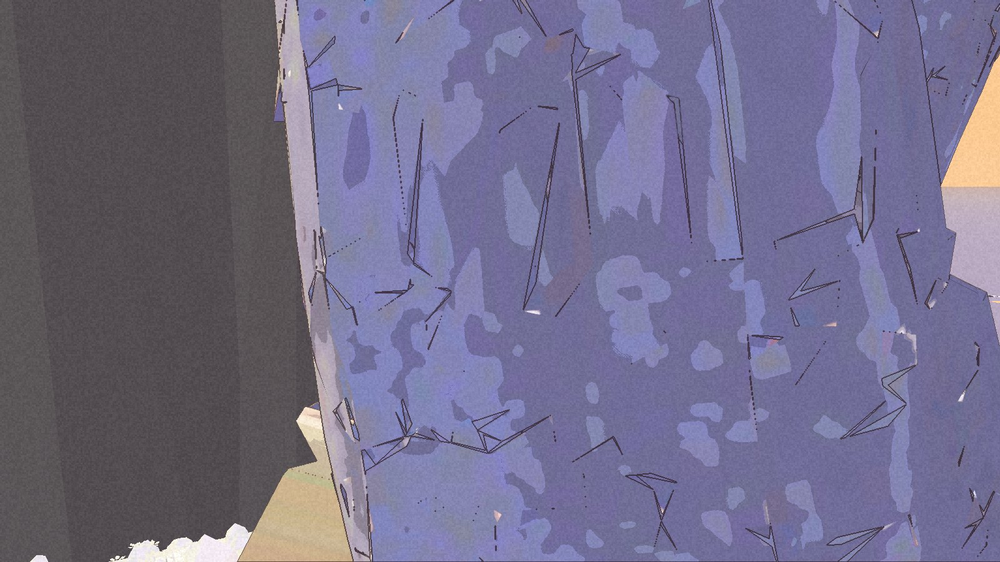

The High Pass has lost its placeholder label. It has not yet learned where to stop.

HP-1 was built and packaged on 6 November. The development picker reaches the refuge terrace and returns to the courtyard. That check passed. The reviewer **failed the full playable walk**: the stair lets Kai past its intended boundary, and the lookout drops him below its floor.

This is a limited private terrace and art preview, not an accepted High Pass walk. Nic has not accepted this checkpoint. The [public demo](/download/) remains 0.1.0.

## A name on the same terrace

The route change gives High Pass its name and widens the area that recognises Kai’s arrival. The buildings, steps and door are retained. This is not a new landscape pass.

The refuge, tree, lake and arch still resemble the painting’s arrangement. The flat dark mountain, angular shore, repeated conifers and lavender band beyond it remain visible departures. Nic’s earlier decision to keep the small yellow flowers still stands.

## Two edges, two failures

The cover shows the end of a twenty-second push at the stair. Kai slips around the small stop and travels roughly thirty-five metres onto the hillside. He stays on solid ground. That does not make it the intended route.

At the lookout, the push drops Kai about two metres. Several return targets are missed before he eventually recovers. The run does not show a permanent trap; it does show a gap between a supported stop and a usable return.

The automated walk reached twenty-two of twenty-seven targets. No sea catch or fall recovery fired. Neither fact repairs these failures.

## The door needs a different proof

The continuous walk also failed to enter the refuge. Its two attempts faced the wrong way and never used the door. A separate check entered and left successfully, so this is not evidence that the door is broken. It is a missing continuous approach, entry and return.

The package checks exited cleanly and left the original save and settings unchanged. The corrected picker run saved only after returning to the courtyard. An earlier picker attempt failed because the pointer changed the selection; that failure stays in the record. Fixed comparison views and the distant-view checks passed within their existing limits. There is no new performance measurement or human free-walk proof.

Settlement owns the two boundary corrections and the door-test headings. The coordinator must then repeat the same pushes, ordinary descent and continuous door loop. The corrections must keep the intended path open. Passing those checks is the next step, not another picture of the terrace.

The [world page](/world/#high-pass-refuge) and [roadmap](/roadmap/) carry the limited status. The lake is still there. The way back needs work.
