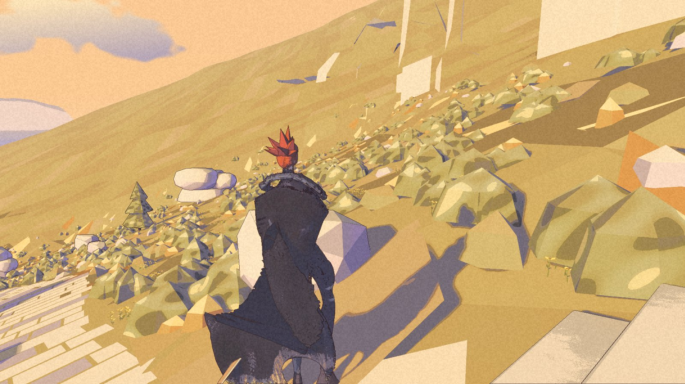
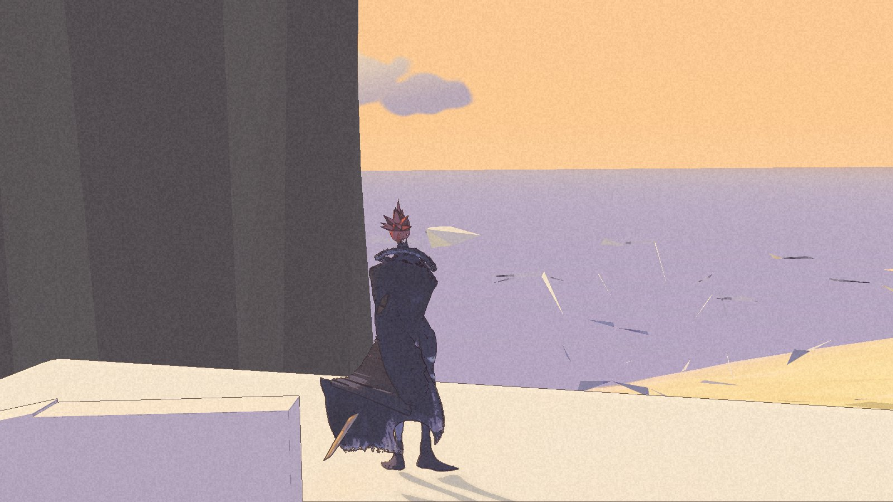
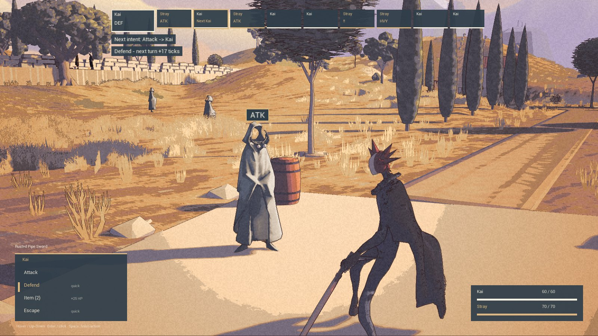
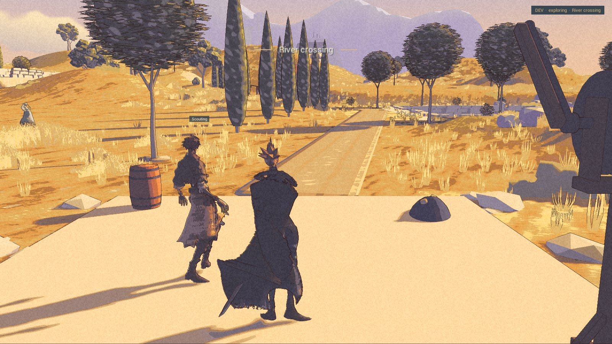

The refuge has an inside again. This time the walk actually went there.

Nic accepted HP-1b and the B9 battle preview on the morning of 7 November. The High Pass reviewer closed the three failures in [the previous checkpoint](/updates/2026-11-07-the-stair-does-not-stop/). These are accepted private development checkpoints. The [public demo](/download/) remains 0.1.0.

## The steps keep their edge

The stair stop has been recut and joined to its neighbours. The lookout has a supported apron. The door test now faces the door before trying to use it.

The packaged walk reached all twenty-nine targets. Both refuge transitions worked, and the continuous route photographed the room before returning to the porch. Twenty-second pushes held at the stair and lookout; the lookout return reached its targets in order. The old thirty-five-metre escape and two-metre drop are closed in these checks.

The first attempt stopped at a distant-view comparison and restored the previous route. The second passed against fresh comparison frames, without using the permitted older-image fallback. The harbour comparison sits exactly at its existing limit. All three private package checks exited cleanly and left the original save and settings unchanged.

The dark massif, angular shore, repeated trees and visible new edges remain prototype art. Acceptance covers this bounded terrace slice. It does not establish every side approach, a walking road to the pass, or measured performance.

## When Kai comes back

B9 puts “Next Kai” on the turn order and explains the highlighted command’s projected return. In the recorded first turn, Attack shows +25 ticks; Defend shows +17. The projected time and later order change. Kai’s cell stays third in these frames, so this is not a demonstration of the cell moving along the row.

Selecting a command does not spend the turn. Confirmed Defend returns at its previewed time, and the next turn remembers Defend. The recorded fight proceeds through Charge and Heavy Strike before Escape returns Kai to the road.

Normal and Reduce motion runs passed the bounded checks. They used scripted input and fixed-step captures. They prove the displayed states and sequence, not physical keyboard or mouse handling, real-time responsiveness, or the removal of all battle motion. The costs and battle rules are unchanged.

## Rex was missing a file

The B9 captures were solo because the package lacked Rex’s profile. W1 restores that existing profile. Its clean packaged check loads Rex, shows him beside Kai at the river and completes the battle plan and return. The same package also passes the High Pass picker check.

This repair is packaged, not newly accepted by Nic. The return screenshot misses Rex, though the log places him nearby. Route-history warnings remain recorded with no gameplay effect observed in this run. Other encounters and Nic’s own save were not played. Body, face and broader following work stay parked.

The [world](/world/#high-pass-refuge), [battle](/mechanics/#battle-checkpoint) and [roadmap](/roadmap/) entries now carry these limits. The next proof is wider play, not a wider claim.
