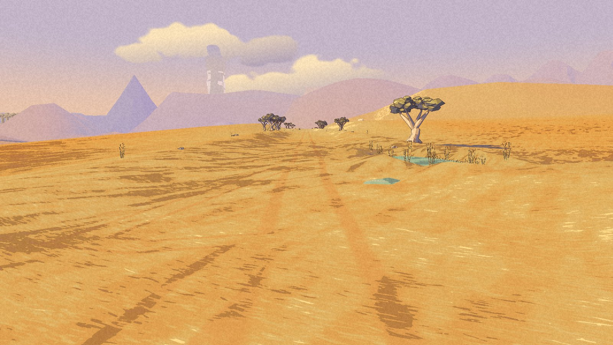
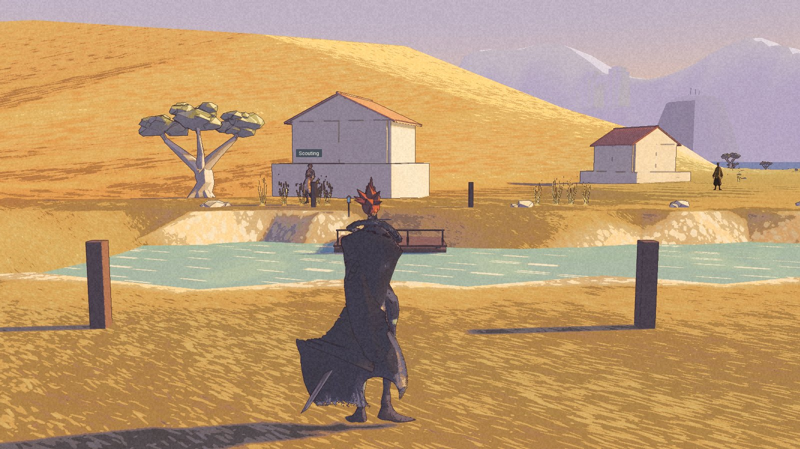
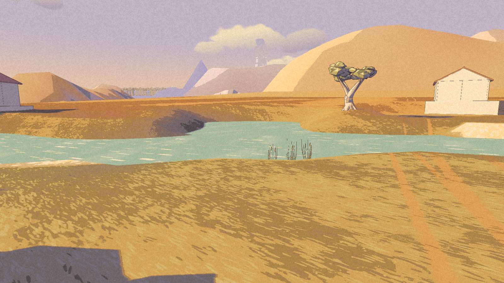

There is a little water before there is much water.

Shadow Country now has a packaged approach from the River village on the Long Road. A small planted pocket gives the first hint. A turn and a bank interrupt the view, then the basin opens out. The name remains darker than the place.

**Built and packaged, with no Nic acceptance recorded yet.** These frames are from the internal W4 checkpoint of 8 November. The [public demo](/download/) remains 0.1.0.

## The crossing comes back

The packaged walk reached all fifty-six targets, from the River village into Shadow Country and back, without a recorded fall or sea catch. Four boundary-push checks covered sixteen cases with no errors. Those checks sampled Kai’s centre; they do not prove continuous contact or every possible side approach.

The ferry initially carried Kai across and then ignored the return press. Its landing point was two metres from the interaction, outside its reach. The new landing is close enough. Both directions passed in W4, without reseeding Kai on the far bank. The crossing uses the existing fade transition; this is not a claim of an animated boat journey.

The earlier floating stones have been grounded. The straight paved trough has given way to irregular banks. Hard-edged foreground shadows remain, traced in the source review to the placeholder trees. They are an open art finding, not a finished match to the painting. The change of look along the approach still needs its visual review.

## Remembering the bank

A separate private campaign check walked into Shadow Country, quit, continued at the saved spot, walked back to the River village, and repeated the save and Continue there. All four launches passed. Nic’s original save and settings stayed unchanged.

That proof belongs to the earlier W3 package. W4 changes the stones, banks and ferry landing, not the terrain along that test line, but the campaign check has not been repeated on W4. The successful run began with one diagnostic placement, then restored walking before the route. It proves the retained save locations and sampled grounded poses, not every frame of movement. Earlier failed checks, including a launch crash and a run left in flying mode, remain in the record.

## The road knows the town again

The first High Pass road leg has also been rebuilt after [its place boundary claimed Havenwood](/updates/2026-11-07-the-road-calls-the-town-its-own/). The corrected package keeps the town’s place name and one picker entry per label. Its seventy-six walk targets and 167 boundary probes passed. One launch crashed; the repeat passed. The road is still bare, and it still does not reach the terrace.

A later check of the second leg found a different obstruction: Rex. He could not find support on the narrow tread, stood still, and blocked Kai’s return. Only five of ten pilot targets were reached. The second leg was restored out of the project.

**Correction, later on 8 November:** the source audit corrected the first-leg log attribution. Those counted refusals were mainly at a Cove edge, with no first-road actors hit. They do not establish the same tread failure on road one. The second-leg obstruction described above remains a verified failure.

The [roadmap](/roadmap/) keeps that repair open. Shadow Country has a way across and back. The mountain road still has someone standing in it.

**Later checkpoint, 8 November:** [Room to pass](/updates/2026-11-08-room-to-pass/) records the rebuilt second leg and actual crossings past Rex. Friendly bodies can now overlap; following remains unfinished.
