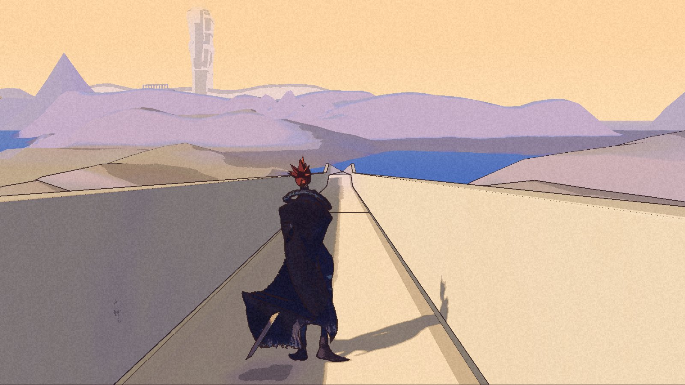
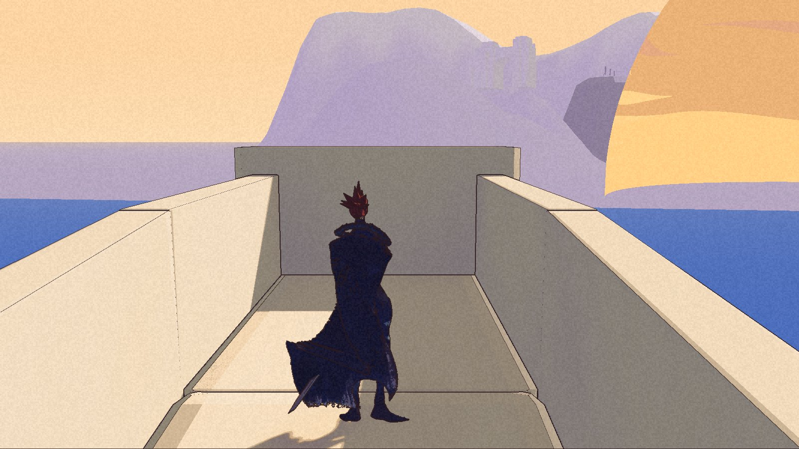

Rex has not learned to step aside. Kai can get past him now.

The second High Pass road leg was rebuilt after [Rex blocked the return](/updates/2026-11-08-a-way-across-the-water/). The new private package passed its pilot, full walk and boundary checks on 8 November. It opens the first leg’s end wall and continues for another roughly 1.75 kilometres, climbing about 175 metres. There is another closed end beyond it. The terrace is still not connected.

**Built and packaged; no Nic acceptance is recorded for this checkpoint.** The [public demo](/download/) remains 0.1.0.

## Through, not around

The change lets Kai and Rex pass through each other while moving. Their bodies can visibly overlap for a moment, as the cover shows. This is the cost of removing the friendly obstruction; it does not teach Rex to follow the narrow road.

The pilot crossed the earlier stopping point three times, including opposite headings, while Rex stayed in place. Kai remained grounded and reached the other side. A further crossing occurred in the full walk. The twelve pilot targets and fifty-six full-walk targets all passed, with no recorded fall or sea catch.

The change is limited to movement between Kai and Rex. World and enemy collision settings remain in place. The 159 attempted boundary crossings stayed contained in the recorded checks, and the battle preview, escape and return check passed with Rex loaded. That is bounded evidence, not a complete enemy-collision or reload audit. Nic’s original save and settings stayed unchanged.

Rex may still stay behind. Replacement and reload behavior beyond the battle return, wider following, human steering and performance remain open.

## Another wall

The side banks are 1.65 metres high. At the lower review cameras they rise above eye level, making the road read as a trench and hiding the landscape. The new end is a plain wall. The walk passes; the blockout has not become finished art.

## A correction to the earlier record

The first failed second-leg pilot really did stop against Rex. Our earlier update also repeated an attribution from the coordinator: that the first leg’s refusal logs showed the same road-tread failure. The later source audit corrected that count. Most refusals were at a Cove edge, with smaller groups at stairs and other locations; none of those recorded hits were on first-road actors.

The second-leg diagnosis is narrower and clearer. Rex’s three-metre sideways scouting goal lay outside the narrow raised tread. The new passage rule removes the obstruction without weakening floor checks or pretending that this unsupported goal has been fixed.

The first failed run remains failed. This package supplies the later crossing evidence. The [roadmap](/roadmap/) keeps following and the next road leg separate from it.
