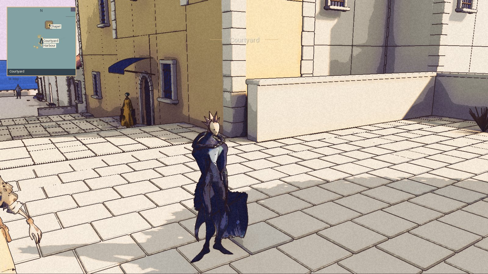
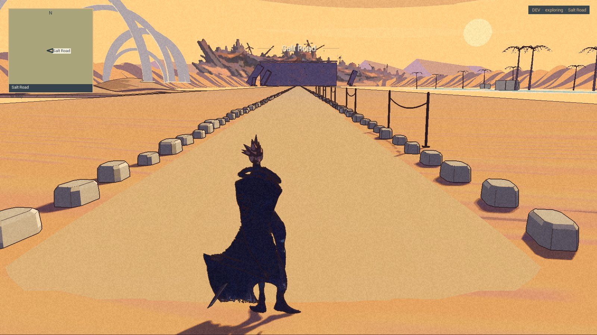

The map knows some names before it knows the ground beneath them.

The internal build now has a minimap in the corner and a larger map opened with M. North stays at the top. The full map can pan, zoom and return to Kai’s position with Home; M or Escape closes it. The minimap covers an eight-hundred-metre span.

**Built and packaged, with no Nic acceptance recorded. The timing gate still fails.** This is the M1 preview of 9 November, not a new [public demo](/download/). Demo 0.1.0 is unchanged.

## Where Kai is

The package loads thirty-nine points of interest. The retained control checks opened and closed the map twice in the courtyard, at High Pass and on the Salt Road. Pan, keyboard zoom and Home were recorded; the High Pass and Salt Road centres matched their proof points, and the courtyard centre was within nine metres. Nic’s original save and settings stayed unchanged.

Two earlier attempts did not prove what they intended. A moving pointer sent the courtyard check to High Pass through the development picker. On the Salt Road, an early map press fell inside the arrival transition, where the map correctly refused to open. The later checks corrected those sequences. They do not erase the earlier failures.

The ordinary review captures kept the map disabled, and their fixed town comparisons passed. That preserves those comparisons; it is not a complete audit of every map interaction.

## What the paper leaves out

The first atlas is too coarse around the High Pass terrace and road pieces. Its western edge cuts off the lake and the planned approach. The Opening Desert is reduced to a tiny footprint; the Salt Road appears as a flat olive patch.

Blank paper means the map does not represent that ground. It does not promise land to walk on. The distant names do not create connections between the built slices.

## The cost is still too high

A separate run measured the map without taking screenshots. The full-map timer averaged about 0.159 milliseconds, but its worst recorded batch maximum reached 0.586 milliseconds. The minimap maximum reached 0.855 milliseconds. Both exceed the 0.3-millisecond limit.

Those spikes cannot be dismissed as screenshot work: this run took none. The timer alone also cannot separate map execution from a pause or scheduling delay inside the measurement. The gate remains failed. A more detailed map and revised drawing work are staged for another package; neither is shown as finished here.

The [roadmap](/roadmap/) keeps the map’s cost and missing detail open. It also records Nic’s new direction: a continuous open-world journey to High Pass, rather than more enclosed road legs. The map is a first aid to that journey. It is not the journey.
