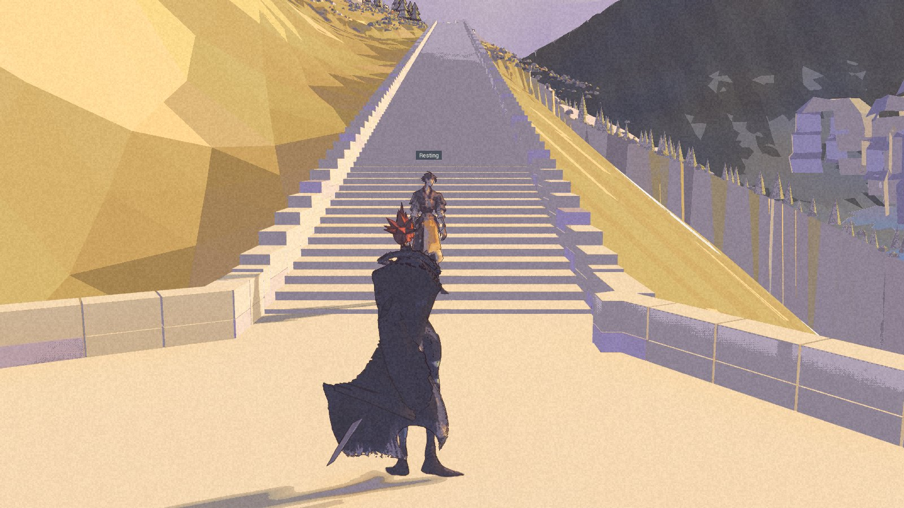
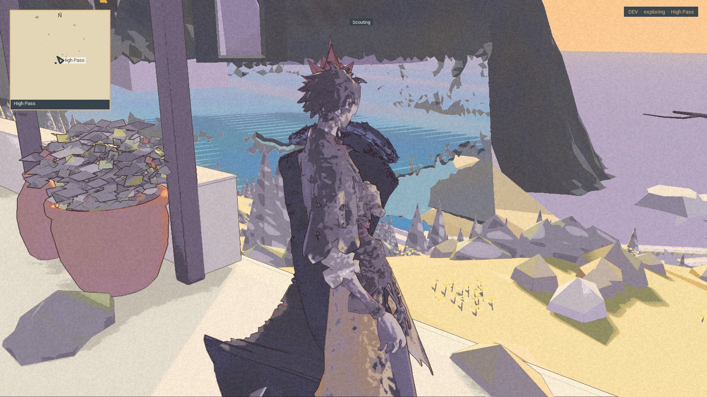

**Later on 12 November:** the next package completed its walk, but Nic rejected the approach’s art and the candidate was restored out. [Read the result and verdict](/updates/2026-11-12-the-walk-passes-the-place-does-not/). The frames below remain the earlier run 18 record.

The lake has a way up. The proof has one more way to go.

The new High Pass approach climbs from the lakeshore through switchbacks and a stone stair to the existing terrace. In run 18, all seventy-eight targets of the editor walk were reached in order. The short shore and stair pilots passed too. The worst recorded target errors in the full walk were fifty-one centimetres across the ground and sixteen centimetres vertically; no sea, fall or catch event was recorded.

**Built and packaged, with a clean picker launch to High Pass. No Nic acceptance of the approach is recorded. The full packaged walk remains unproved.** This is an internal checkpoint of 12 November. [Demo 0.1.0](/download/) is unchanged, and there is still no completed walking connection from town to the refuge.

## What held the feet

Earlier walks stopped near the upper stair. The repair moved four invisible collision records while preserving the visible scene. The corrected editor walk reached all its targets; forty-two side-push shots recorded no target reached and no sea or fall event, and the refuge door check passed in both directions. These bounded checks do not establish unrestricted human movement, complete companion following or finished art.

## A shadow kept in the record

One town comparison still failed its original rule. A patch beneath an eave changed between two captures with identical project content. Nic chose a documented exception for that precise camera and patch before run 18.

Run 18 used that exception for camera 05. The raw failure remains in the evidence. The other three distant-view cameras passed their strict checks, and the fixed scene comparisons passed. This is a bounded exception, not a general relaxation of the visual checks.

## Where the package stops

The package launched, the development picker travelled to High Pass, and the process exited cleanly. Nic’s original save and settings stayed unchanged.

The next tool was supposed to prepare a continuous arrival-to-shore-and-back walk. It still expected sixty-four strips after the route’s test sequence had grown to seventy-eight. That tool stopped before the packaged walk could run. The Coordinator corrected it and began another run; this post does not claim that later run’s result.

The archived run 18 package is retained as failed-window evidence. Its editor traversal and packaged arrival are useful, limited results. Lakeshore cottage readability, broader art acceptance, companion behavior and performance remain open. The western mainland and continuous journey remain on the [roadmap](/roadmap/).
