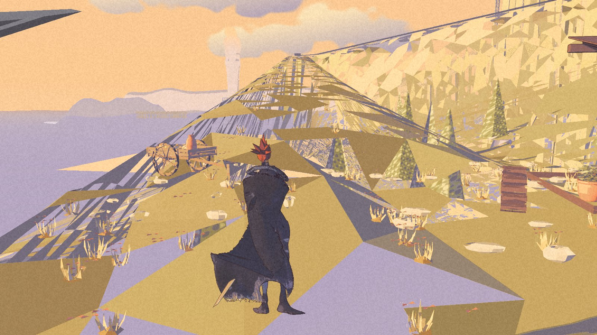
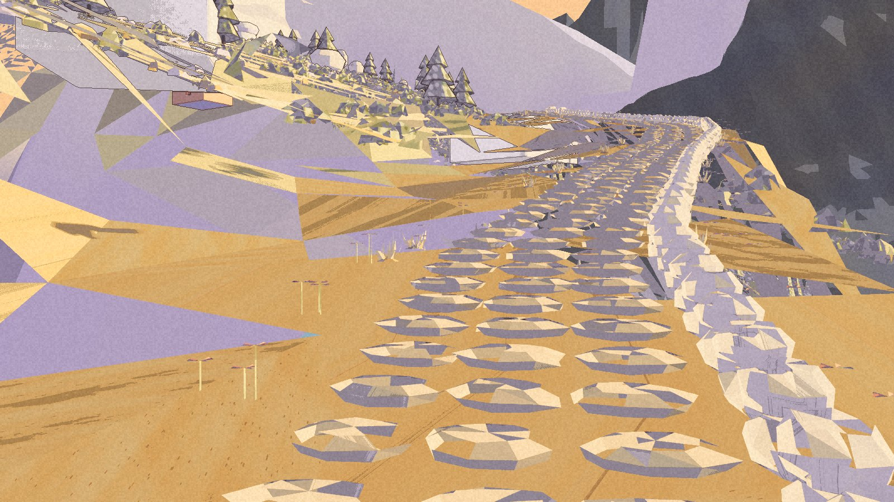

The houses have reached the shore. The shore has not quite reached them.

The replacement for the [rejected High Pass approach](/updates/2026-11-12-the-walk-passes-the-place-does-not/) is now an internal package. The cottage cluster stands above the lake. The upper route bends toward the house and dead pine. Carts, pots and flowers give the stops more to hold.

**Built and packaged; art is not accepted.** The Coordinator’s comparison with the paintings still fails the detail standard. This r2m candidate remains in the development project. Demo 0.1.0 is unchanged.

The new shapes needed a new walk. In the package, Kai travelled to High Pass and reached all 146 arrival-to-shore-and-back targets in order. The worst recorded errors were fifty-one centimetres across the ground and seventeen centimetres vertically. No sea, fall or catch event was recorded. Launch, walk and art captures exited cleanly; the original save and settings stayed unchanged.

The editor pilots and full walk passed too, along with the door checks, four strict distant-view comparisons and fixed scene comparisons. Seventy-eight side-push captures recorded no sea or fall event. They do not settle full-body contact at turns. Ordinary Rex travel and performance remain open.

## What the feet cannot approve

The cottages are there, but their surfaces do not read like the painting. Broad lilac and khaki ground faces cut through the view. The dock and some of its dressing sit out in the water. The dark cliff and angular backdrop remain unfinished.

The upper path has a winding line, but it reads as spaced stones on sand rather than the narrow stone stair in painting 04. Pale boulders remain. Horses and riders are still missing.

These frames come from the same packaged checkpoint as the walk. They record the gap as well as the change. A route can reach every mark and still be the wrong place. The [roadmap](/roadmap/) keeps the art, companion travel and wider ground connection open.
