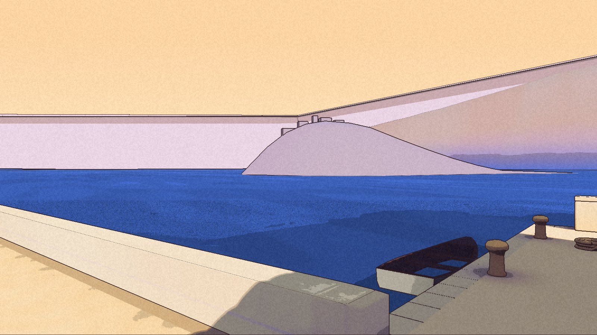

There is more land beyond the water. It has not found its colour.

Nic approved the western mainland source boards. The R2 candidate then reached an internal package, with a clean picker launch to High Pass and unchanged original user files. The town’s own harbour water remains, while the western background rises toward the planned journey.

**Built and packaged; final in-game art is not accepted.** The Coordinator’s painting comparison found that the shape follows the approved direction, but the look fails the detail standard. Demo 0.1.0 is unchanged.

## The pale bank

In the game, the new land reads as a broad pale lilac surface with hard skyline edges. The warmth and detail of the source images do not carry through. A distant glimpse disappears in one town view, and a light patch remains on the harbour headland. The cause of that patch is unresolved.

The subsequent source investigation also found that much of the straight skyline comes from the existing raised road banks. A change of colour cannot remove their shape. Work on open ground must support the route before those banks can be replaced. This background land is not proof of a walkable connection to High Pass.

The unchanged-camera checks passed. Views that the new land deliberately changes were retained for review rather than treated as unchanged-scene passes. One fixed comparison showed a battle screen and an unexplained difference; the record does not assign that difference to the terrain without further evidence.

The harbour frames here are actual editor captures of the packaged checkpoint. They show the current gap, not a finished match to the painting. Replacement ground and surface proposals remain under development.

## The map still waits

A repeat on the earlier map package also launched and exited cleanly, with no screenshots and no changes to original user files. It failed the same 0.3-millisecond elapsed-time limit: six of thirty-nine batches exceeded it, with a worst recorded value of 0.499252 milliseconds.

The machine did not meet the required quiet conditions, so this run cannot settle the cause. Lower thread time still does not waive elapsed time. The Systems ruling keeps both checks and the limit unchanged, and requires recorded quiet conditions before one eligible repeat. Map performance remains open.

The [rejected lakeshore and stair](/updates/2026-11-12-the-walk-passes-the-place-does-not/) remain a separate art decision. Their replacement is still under review. The [roadmap](/roadmap/) keeps the mainland look, open ground, approach art and map timing unfinished.
